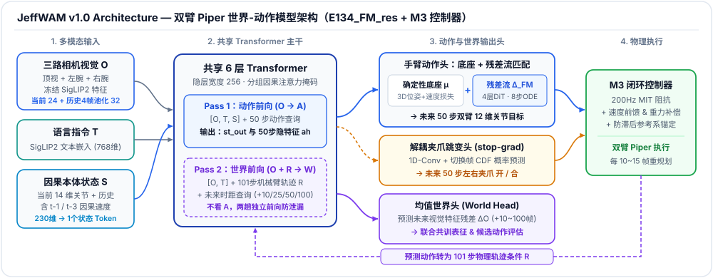

# 模型结构说明 / Model Description (Stable v1.0)

本文档按当前稳定版本 1（`v1.0.0`，对应 `code/code_e134/` 与 `code/code_e132/`）的实际代码实现撰写。

## 1. 多模态输入（O / T / S）
- **三路相机视觉 `O`（冻结）**：冻结的 `SigLIP2-base-patch16-224`，保持宽高比缩放与边缘填充（`code/code_e86/e86/vision.py`）。顶视、左腕、右腕 3 路相机每帧 14×14 patch 隐藏状态按有效区池化为 `2×4` 个 768 维 token；当前帧 `24` 个 token + 过去 4 帧（`-24/-18/-12/-6`）经 AttentionPool 压成 `32` 个 token，共 `56` 个视觉 token。
- **语言指令 `T`**：SigLIP2 `get_text_features` 768 维文本嵌入，带可学习空文本占位 token；P3 默认使用固定通用指令，并保留权重 `0.01` 的对比对齐损失。
- **因果本体状态 `S`（`230` 维）**：在原 164 维历史关节/末端位姿基础上（`code/code_e129/`），新增 `t-1` 与 `t-3` 因果速度特征（共 `230` 维），经 `state_proj` + `proprio_proj` 融合为 `1` 个状态 token。

## 2. 共享 6 层 Transformer 主干（两趟独立前向）
- 工程配置：6 层、隐层宽度 `256`、8 头注意力、FFN `1024`，带分组因果注意力掩码。
- **Pass 1（动作前向 `O → A`，无世界 token）**：输入 `[O, T, S]` + `50` 个动作查询位置，输出状态隐特征 `st_out` 与 50 步动作隐特征 `ah`。动作头不读世界头 `W`，确保推理零泄漏。
- **Pass 2（世界前向 `O + R → W`）**：将动作转为 `101` 步前向运动学物理轨迹条件 `R`，与 `[O, T]` 及未来时距查询（`+10/+25/+50/+100`）送入同一主干；长时域（`>50` 帧）额外屏蔽 `A`，阻断间接泄漏。

## 3. 动作输出头（`E134_FM_res`）
- **手臂底座 + 残差流匹配**：
  - **确定性底座 $\mu$（`delta_head`）**：输出未来 50 步相对当前关节角的标准化增量，由无权重 L1 + 可微正运动学 **3D 指尖位置/朝向 L1 + 步进速度斜率 L1**（`code/code_e133/`、`code/code_e134/`）联合监督。
  - **残差流匹配头 $\Delta_{\text{FM}}$（`TemporalFlowHead`）**：4 层 AdaLN-Zero Temporal DiT + Depthwise-Conv1D 速度场网络，在平滑 `AR(1)`（$\rho=0.85$）轨迹噪声先验上学习残差速度场；推理采用 8 步 Midpoint ODE 采样（`mean8` 均值或单次采样 `s1`），最终输出 `q_cur + (μ + Δ_FM) * std`。
- **梯度解耦夹爪跳变头（`DecoupledGripperSwitch`）**：
  - 从 `st_out.detach()` 与 `ah.detach()` 读取特征（完全隔离夹爪强加权梯度对主干手臂精度的干扰），经 `20%` 夹爪专用 Dropout + 1D-Conv + 切换窗/切换帧 CDF 概率头，输出未来 50 步左右夹爪开/合二分类（阈值约 `5.25 / 12.75 mm`）。

## 4. 均值世界头（World Head）
- 预测未来视觉特征残差 `y = (z_future - z_current) / scale`，训练采用四模式等权混合（`25% gt + 25% detached_N1 + 25% no_traj + 25% action_only`，`code/code_e129/`），消除旧版对自身预测动作的暴露偏差；链式约束采用 C2 严格开环端点监督。
- 用 `E134_FM_res` 单条采样轨迹驱动世界头时，`+50 / +100` 步特征保留率由确定性模型的 `11.6% / 2.6%` 提升至 `19.1% / 8.6%`。

## 5. 物理执行层（`M3` 闭环控制器，`code/code_e132/`）
- 在实机标定 MIT 阻抗参数（`kp = 10.0, kd = 0.8` + RNEA 重力补偿 + `1.8 rad/s` / `4.5 rad/s²` 限幅）下，新增：
  1. **MIT 速度前馈** `+kd * (v_cmd - v_cur)`，大幅压低柔顺阻抗跟随滞后；
  2. **期望参考系防滞后重锚定（带抗积分饱和限幅 `±0.08 rad`）**，避免每 `10～15` 帧闭环重规划时把历史跟随误差重复清零累积。

## 6. 独立旁路阶段控制器（不回流进主干）
- 21 个因果谓词（SigLIP2 池化 3 相机特征 `2304` 维 + 逻辑回归，AUROC `0.908`）→ 校准发射至 10 阶段 → 因果在线 HMM（±90 帧阶段边界召回 `0.726`）。

## 7. 已知边界与下一步方向
- 突发大幅度快速上提动作仍存在约 38% 幅度偏保守（见 `E134` `win=166` 与 `E135` AR 叠加视频第 14.5 秒左臂）。
- 完全 `stop-grad` 的夹爪头虽保住了手臂精度，但损失了一部分主干对夹爪跳变的视觉敏感度，下一代可改为 `0.1×` 小比例梯度回传或夹爪独立视觉交叉注意力。
