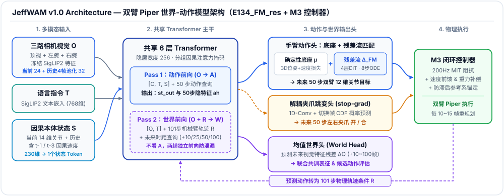

# JeffWAM (Stable v1.0)

双臂（Piper）扎带穿孔任务的 **World-Action Model（WAM）** 稳定版本 1（`v1.0.0`）研究代码快照与实验报告。  
A stable v1.0 research snapshot of a bimanual (Piper) zip-tie threading **World-Action Model**: architecture, code, MuJoCo closed-loop & real-video AR verification, and experiment reports.

> **状态 / Status**：研究代码快照（`v1.0.0`），**不含数据集、权重、特征缓存与原始视频**；代码里的路径指向作者工作站，同事用户名、内部主机名与 IP 已脱敏为占位符。  
> Research snapshot (`v1.0.0`): datasets, checkpoints, caches, and raw videos are excluded; colleague usernames, hostnames, and IPs are replaced with placeholders.

---

## 架构一句话（v1.0.0：`E134_FM_res` + `M3` 闭环控制器）

冻结的三路 **SigLIP2** 视觉特征（顶视 + 左腕 + 右腕，当前 24 token + 历史 4 帧池化 32 token）+ 语言指令 token + **230 维因果本体状态**（含 `t-1 / t-3` 速度特征）→ **共享 6 层 Transformer 主干**（两趟独立前向，互不泄漏）：
- **Pass 1（动作生成 `O → A`）**：
  - **手臂头**：确定性底座 $\mu$（受可微 3D 指尖位置/朝向 + 步进速度斜率损失约束）+ **4 层 AdaLN-Zero 时序残差流匹配头**（`TemporalFlowHead`，8 步 Midpoint ODE 采样）；
  - **夹爪头**：梯度隔离（`stop-grad`）的 `DecoupledGripperSwitch`（1D-Conv + 切换帧 CDF 概率头），输出未来 50 步左右夹爪开/合；
  - **物理执行层**：`M3` 200 Hz MIT 阻抗控制器（重力补偿 + 速度前馈 + 防滞后期望参考系重锚定，每 10～15 帧闭环重规划）。
- **Pass 2（世界预测 `O + R → W`）**：将预测动作转为 101 步物理轨迹条件 `R`，驱动均值世界头预测未来 `+10/+25/+50/+100` 帧视觉特征残差。
- **独立旁路**：21 因果谓词 → 10 阶段 → 在线 HMM 阶段控制器。详见 [`MODEL.md`](MODEL.md) 与 [`docs/architecture_v1.svg`](docs/architecture_v1.svg)。

---

## 目录说明 / Layout

| 目录 / 文件 | 说明 |
|---|---|
| `docs/architecture_v1.svg` | 稳定版本 1 模型架构与两趟数据流总图 |
| `code/code_e82` → `code/code_e122` | 早期基础架构、世界头与语言/阶段探针实验（A2 路径基线为 `code_e102a` / `code_e106c`） |
| `code/code_e123` → `code/code_e130` | 世界头局部敏感性、阶段条件证伪、全池联合共训、`230-D` 因果速度升级与误差归因诊断 |
| `code/code_e131` → `code/code_e132` | 双臂 Piper 精确运动学 MuJoCo 闭环仿真基准（0.000mm FK 对齐）与 `M3` 阻抗滞后重规划修复 |
| `code/code_e133` → `code/code_e134` | **v1.0 核心模型代码**：3D 指尖位姿/速度损失（`G1`）、解耦夹爪跳变头与残差流匹配动作头（`FM_res`） |
| `code/code_e135/` | 真机实拍视频 + 轮廓自动标定 3D URDF 半透明虚影与 50 步轨迹叠加可视化验证 |
| `notes/` | 全量实验报告（含所有否定/证伪结论）与按时间排序的 `worklog.md` |
| `robot_models/marvin_m6/` | Marvin M6 参考网格（第三方资源，见 `NOTICE.md`）；Piper 运动学链直接写在代码中 |

---

## v1.0 核心验证结果摘要（211 个留出验证窗 / 27 parent）

| 模型版本 | 前 8 步 `l8` | +50 步位置 / 姿态 | 松爪瞬间位置 / 姿态 | 世界头 `+50 / +100` 保留率 | MuJoCo `M3` 闭环 `S2` / `S4(15mm扰动)` | 碰撞 (桌/臂) |
|---|---:|---:|---:|---:|---:|---:|
| `E106-C` (原默认基线) | 0.00783 | 37.99mm / 11.40° | 27.95mm / 8.51° | — | — | — |
| `E129 WAM_v1` (`230-D` 速度升级) | 0.00709 | 34.98mm / 11.13° | 25.67mm / 7.41° | 11.6% / 2.6% | 35.05mm / 45.58mm | 0/0 , 0/0 |
| `E133_G1` (+3D位姿/速度斜率) | 0.00695 | 34.57mm / 10.91° | 25.56mm / 7.23° | — | — | — |
| **`E134_FM_res` (v1.0 残差流匹配)** | **0.00689** | **34.12mm / 10.85°** | **22.69mm / 6.87°** (`s1`) | **19.1% / 8.6%** | **35.81mm / 45.53mm** | **0/0 , 0/0** |
| `blind_t1` (无视觉纯本体基线) | 0.00560 | 36.63mm / 10.43° | 58.51mm / 15.34° | — | 46.96mm / 59.77mm | 0/2 , 1/2 |

- **真机实拍 AR URDF 叠加验证（`E135`）**：在完整 18.3 秒实拍成功回合（`episode_62`，550 帧）上通过纯臂轮廓标定（`IoU = 0.643`）叠加 3D 预测虚影，全段平均末端误差 `16.7～17.1 mm` / 姿态 `4.4°`；直观验证 WAM 在瓶口抓扎带与左提右松换手节点准确触发夹爪开合（无视觉基线均漏抓/死夹），同时暴露突发大抬臂存在约 38% 幅度偏保守的已知短板。

---

## 约定与限制

- 仅使用 Piper 真机数据训练（**严禁使用 MuJoCo 仿真数据训练**）；`episode142` 永久排除；动作与标签不做时间平移。
- 第三方模型与资产说明见 [`NOTICE.md`](NOTICE.md)；暂未选择开源许可证，默认保留所有权利。
