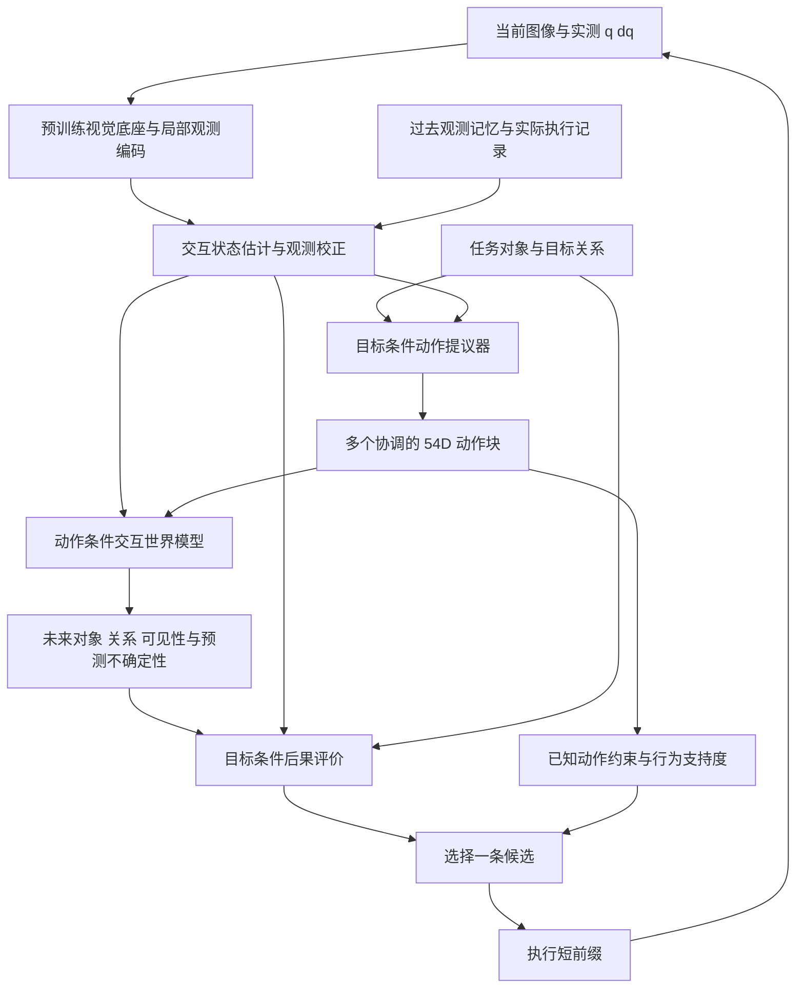

# 面向天机双臂灵巧手的完整端到端 JEPA 决策模型构思

日期为 2026-11-10。本报告给出整体架构设计，不延续上一轮以局部消融为主的组织方式。设计依据是现有任务约束、五组实验及 E55/E61/E64/E65 等已有证据，并参考动作条件世界模型与联合动作生成研究。本次没有实现模型、恢复训练、使用 GPU 或运行仿真。

## 1. 总体选择

**如果重新设计，我会选择一个“维护交互状态、生成动作提议、预测后果、依据目标选择、观测后校正”的目标条件预测控制模型。JEPA 负责学习可预测的交互状态变化，动作生成器提供行为先验，任务评价器负责把后果与目标联系起来。**

完整模型的核心状态不再以整幅图像的 960 个未来 token 定义。它应维护机器人、手、瓶、箱及其关系的紧凑状态，保留局部视觉细节和无法确认的信息。整图表征仍可作为观测输入及辅助约束。

两个核心变化如下。

1. 从单帧视觉特征出发，提升为持续更新的交互状态估计。模型要记得遮挡前发生了什么，也要知道当前哪些结论没有观测支持。
2. 明确后果预测在决策中的职责。动作头提供多个提议，最终选择显式依赖后果评价。单纯给动作头拼接一个预测终点，不能保证这个信息被使用。

目标架构可以端到端执行并分阶段训练。它不要求所有模块从初始化起都被同一个自评分数共同优化。当前只有示教，缺少候选执行结果，这一区分直接关系到模型能否学到可信行为。

## 2. 用一个明确的分解定义全模型

令观测历史为 \(h_t\)，包含截至当前的图像、实测 q/dq、历史有效性及记录可靠的实际执行命令。定义

\[
b_t=F_{\mathrm{obs}}(h_t),\qquad
A^k\sim\pi_\theta(A\mid b_t,g),\qquad
\widehat B^k\sim P_\psi(B\mid b_t,A^k).
\]

其中 \(b_t\) 是当前交互状态，\(g\) 是任务目标，\(A^k\) 是候选动作块，\(\widehat B^k\) 是整段预测状态变化。随后

\[
k^*=\arg\min_k J_\eta(b_t,\widehat B^k,A^k,g).
\]

这建立三个明确条件分布和一个选择算子。生成器学习什么动作可能有用，世界模型学习给定动作对应的后果，评价器判断后果与目标的关系。

**任务目标 g 进入动作提议和评价，不直接进入物理转移模型。**同一交互状态下执行同一动作，其物理后果不应随期望目标改变。目标也不应把感知状态改写成想要看到的结果。该条件分解为结构约束，不能仅凭它就宣称从示教识别了因果效应。

图中执行与再观测是目标系统的闭环接口，当前尚无可用闭环环境。提出这条计算图不代表已经完成机器人闭环控制。

## 3. 交互状态是系统的公共接口

建议将 \(b_t\) 组织成机器人、对象、关系和记忆四部分。潜变量仍然是主要表达，不必把全部知识变成离散符号。

|状态部分|具体内容|在系统中的作用|
|---|---|---|
|机器人状态|实测 54D q、因果 dq、FK、历史有效性|动作锚定、计划几何、运动上下文|
|对象状态|左右手、可见瓶实例、箱的局部特征、二维位置/布局、身份分布、可见性|区分对象并维护局部细节|
|关系状态|手—瓶相对位置、可见围拢、共动、分离、瓶—箱相对关系|连接感知、动力学和任务目标|
|记忆与不确定性|遮挡前状态、近期变化、重复尝试、关系确认程度|支持部分可观测条件下的推断与校正|

瓶实例身份不可靠时，保留多个候选或未知状态。不能用一个瓶并集 token 代表所有对象，也不能把未观测自动当成不存在。

顶视图中的可见共动可以支持抓持推断，但不能直接成为稳定抓握或接触力真值。二维投影进入箱区域也不能直接成为真实落箱成功。这些差异在状态语义上就必须保留，不能等到评分时才补一句不确定。

### 3.1 观测编码

使用一个已有大规模视觉预训练底座，保留少量可训适配能力。当前图像提供局部布局，短时历史提供对应与变化证据。局部提取必须保留空间结构，而不只是对整个手部 ROI 平均。

一个可执行的规模起点是约 32–64 个、256 维的交互 token，包含机器人组、对象局部网格、关系查询和全局上下文。这个数量用于控制预算，尚未证明是最优值。对象 query 从视觉特征读取信息，并通过关系 attention 交换信息，时序模块维护身份和交互记忆。

初版可以沿用 DINOv2 作为观测底座，预留运动编码接口。V-JEPA 类预训练可以初始化运动表征或提供训练期教师，但不要求把 DINO、SAM、视频编码器同时堆叠。完整结构先明确每种信息的用途，再决定是否需要额外编码器。

### 3.2 递归状态估计与校正

模型在收到新观测前可以维护一个预测先验，收到观测后必须校正

\[
b^-_t=P_\psi(b_{t-\Delta},A^{\mathrm{exec}}_{t-\Delta:t-1},\Delta),\qquad
b_t=U_\phi(b^-_t,E(o_t)).
\]

这里的 Δ 是实际经过的帧数，转移显式接收对应动作片段长度与物理时距。原型训练需覆盖 1–4 帧的短转移，规划可以组合使用 4 帧转移，但执行 1–3 帧后不能拿 4 帧预测冒充对应时刻的先验。若暂未训练某种时距，使用因果观测更新器直接更新，不调用时距不匹配的动力学先验。

这里是状态估计的概念接口，不要求使用特定滤波算法，也不保证得到严格贝叶斯后验。实际执行记录若不可靠，就不能把计划动作冒充执行真值。

观测更新必须让实测 q 覆盖对应机器人状态。隐藏物体关系可以融合记忆与新证据，不能因前一步预测很自信就忽略观测冲突。训练时使用因果序列与充分的历史初始化，避免把整段未来编码进当前状态。

该结构使“历史”成为所有模块共用的状态估计过程。它不再只是某个动作头额外获得的两个 token。

## 4. 任务目标与任务进展应进入完整模型

目标 g 表达任务对象、目标容器和希望达到的关系。对当前任务，可以使用结构化目标 token，不必引入语言模型。

例如目标可以包括目标瓶与指定箱的关系、与手的分离，以及撤手后持续保持目标关系的可见证据。真实物理成功与顶视可见代理需要分别定义。没有可观测证据的条件不能硬标为已经满足。

评价需要理解必要中间关系。尚未形成抓持证据时，单纯要求瓶更接近箱几乎不给接近和围拢动作正确反馈。已经运到箱附近时，继续缩小距离也可能诱导不恰当的推挤。因此任务代价要根据当前交互状态评价合理的下一步关系变化，并最终受完整目标约束。

双手可以处于不同阶段，模型需允许一只手接近、另一只手搬运，也允许暂停和重试。不要用一个全局时间进度强制所有对象按同一步骤演化。

我会暂时省去没有外部语义约束的自由子目标 latent 生成器。任务进展先由对象关系与记忆表达，避免出现 E61 中“终点条件可被忽略或子目标失去含义”的类似问题。未来若增加高层子目标，其语义应能用可观察关系检查。

## 5. 世界模型预测整个交互状态的演变

世界模型的输入为当前状态与一条固定候选动作，输出未来对象、关系、可见性和记忆的变化。它不只是产生一张终点 latent。

建议采用同一个带时距输入的转移核心反复展开。规划时一个与现有数据匹配的起点是每 4 帧作一次预测状态更新，32 帧动作块展开 8 次，约覆盖 2.13 秒，并在相应位置读取 h4/h8/h16/h32。观测校正则使用实际经过时距对应的短转移，或直接做观测更新。具体步长需要验证，不能因这个设计就假设短时接触已经被充分解析。

每次转移处理三类信息。

- 机器人候选动作及其计划 FK。提供哪只手将向哪里运动的条件。
- 对象之间的关系交互。允许瓶的内容、位置和可见性变化，并与手部运动相关联。
- 想象中的交互记忆。维护可能的抓持、遮挡和关系变化，而不是每段重新从原始状态猜测。

动作始终以最新实测 q 为统一锚点。推演中的机器人状态、计划 FK 和物体状态属于预测量，不能伪装成新测量。FK 也不能保证命令会被准确执行或直接推出抓稳。

### 5.1 JEPA 的预测目标

真实未来观测经过 EMA 目标观测编码与交互提取，生成目标对象/关系 latent。主要预测损失为

\[
\mathcal L_{\mathrm{JEPA}}
=\sum_h\sum_j w_{h,j}\,
d\big(\hat z^j_{t+h},\operatorname{sg}(\bar z^j_{t+h})\big).
\]

对象 j 的对应由可核验身份或匹配机制处理，遮挡、未知和身份不确定需要掩码或软对应。未来图像、未来掩码和真实事件仅作为训练目标，不能进入部署时的当前状态或候选评分输入。

单纯降低 latent 距离可能保留任意表征变换，因此还需要真实观测上的对象/关系读出与稳定性约束。状态不能只在内部预测上自洽，却无法恢复目标需要的关系。

RGB 重建可作为轻量辅助和审计接口。它可以帮助保留局部细节，但不需要让整幅 RGB 成为主要决策目标。背景可走低成本持久内容路径，把主要动态容量留给交互。

### 5.2 不确定性的表达

对遮挡或分布外状态，保留不确定性输出。原型可从可见性分类和留出预测误差估计开始，后续再扩展多种未来假设。只用一个均值未来，会把不同可能结果混成不真实的中间状态。

多个预测头或 ensemble 可以提供分歧信息，但一致也可能是共同错误。没有独立误差校准时，它只能叫模型分歧，不能叫真实失败概率。任务选择不能只挑多个未来中最乐观的一条。

## 6. 动作生成器与选择器共同组成策略

动作生成器承担行为先验 \(\pi(A\mid b_t,g)\)，输出协调的 32×54 动作块。可以保留 flow matching，但使用 A7/B7/L20/R20 的组表示与跨组交互，最终严格还原 canonical 顺序和 rad 单位。

整块动作的去噪可使用双向动作 attention，因为所有待生成位置在推理时同时存在。观测条件仍严格截止当前时刻。可先生成 K=8 条候选作为计算预算起点，但这个数值不是最优性结论。

候选多样性应尽量体现示教中存在的接近轨迹、手形和时序差异。扩大随机噪声不能保证得到有意义、可预测的动作。保留一条明确的行为先验参考候选，便于判断规划是否确实优于单样本模仿。

每条候选在动作固定后进入世界模型，并根据整段后果评价

\[
J_k=
\mathbb E\big[C_\eta(b_t,\widehat B^k,g)\big]
+\lambda_u U_k
+\lambda_p D_{\mathrm{support}}(A^k\mid b_t)
+C_{\mathrm{known}}(A^k).
\]

|项|含义|监督或依据|
|---|---|---|
|任务代价 C|对象关系是否朝目标及必要中间条件变化|目标定义、真实可见事件与结果标签|
|不确定性 U|当前预测在哪些方面缺少可靠证据|独立留出误差与可见性校准|
|行为支持度 D|候选与当前状态下已见行为支持的偏离|示教分布及经过验证的支持度估计|
|已知约束 C_known|关节范围、速度等可确定约束|机器人合约与经过核验的几何条件|

flow 样本没有自动提供可用的精确密度，不能把任意最近邻距离写成严格的动作概率。顶视图也不能支持未经验证的物体碰撞硬约束。

选择器最终选择一条完整候选，仅执行其短前缀，然后再观测。不要把两种不同抓取模式逐元素平均后执行。前缀长度要由实际延迟与控制验证决定，不能默认 32 步全部开环执行，也不能未经测量宣称整条规划链能达到 15 Hz。

当评分证据不足时，模型应显式记录回退行为先验或请求更多观测。不能靠强制改变选择结果来证明世界模型“被使用”。后果的决策价值最终要由实际选择增益证明。

## 7. 评价器如何学会“好”

预测正确与任务有利是两个不同的学习对象。没有环境奖励，不等于完全无法定义目标。用户已经给出了抓瓶放箱的目标，可以用对象关系及可核验事件建立监督。但没有标签或观测支持时，模型无法自行获得隐藏的成功真值。

评价器应首先在真实观测状态上学习关系和目标满足程度，再接收世界模型的预测状态。真实状态与预测状态使用同一语义读出接口，减少 E65 中特权教师和部署学生信息条件不同带来的问题。

它不能通过真实未来到示教末帧的距离定义全部价值。模型需要知道同样的瓶—箱距离在不同抓持状态下含义不同，也要区分已达到、尚未达到与无法观察。

现有 G3/G5 等标签可以支持部分可见代理，但对释放、持续留箱和物理成功的覆盖不足。这些缺口是评价器的数据需求。应补充对象身份、关系变化、可见性、事件时间区间和结果证据，避免把 unknown 当负例。

**早期示教帧不是失败动作，随机扰动动作也没有自动获得失败标签。**候选选择若用与示教动作的 RMSE 作教师，只能学习模仿排序；它不能升级为真实任务价值。完整架构必须明确每一种监督到底在训练什么。

## 8. 完整模型如何训练

### 8.1 同一模型中的三类监督

观测表示与世界模型以真实数据为锚

\[
\mathcal L_{\mathrm{world}}
=\lambda_z\mathcal L_{\mathrm{JEPA}}
+\lambda_o\mathcal L_{\mathrm{object/relation}}
+\lambda_v\mathcal L_{\mathrm{visibility}}
+\lambda_s\mathcal L_{\mathrm{stability}}
+\lambda_r\mathcal L_{\mathrm{optional\ reconstruction}}.
\]

行为先验以示教动作训练 \(\mathcal L_{\mathrm{action}}=\mathcal L_{\mathrm{flow}}\)。评价器以真实状态上的可核验关系/结果训练 \(\mathcal L_{\mathrm{task}}\)，只有相应标签确实存在才计算监督。

暂不指定新的精确权重，因为对象匹配、标签有效率和各损失量纲尚未实测。先明确目标和梯度归属，再校准尺度，比把旧系数直接搬到新状态上更合理。

### 8.2 梯度边界

观测编码器和交互状态主要接受真实观测关系与世界预测监督。动作头读取公共状态，并具有自己的适配层，初期限制策略梯度改写世界表征。世界模型的 EMA 目标跟随世界表示路径。

评分器的关系读出先由真实观测标签训练。不能让“给自己更高分”的优化压力修改世界模型对未来的预测，或修改评价器对成功的定义。

这些边界并不要求观测编码器全部冻结。E63 的冻结结果也不支持直接把全部视觉学习关闭。公共状态仍然可通过真实数据与 JEPA 学习，只是不同目标的更新责任清楚。

### 8.3 训练课程

|阶段|接通的能力|训练信号|允许作出的结论|
|---|---|---|---|
|A 状态与预测|观测→交互状态→示教动作后果|真实未来 JEPA、对象/关系/可见性|观测与示教分布内预测能力|
|B 行为与目标|状态→动作先验，真实状态→任务评价|示教动作与可核验任务标签|动作模仿、可见目标读出|
|C 完整选择|候选→冻结预测→冻结评价→硬选择|先做独立选择评估|当前数据下的开环选择代理收益|
|D 任务优化|闭环执行反馈→策略改进与再训练|真实执行结果，或单列的可信仿真结果|在相应环境中的任务收益|

阶段 A/B 可以交替优化，并不要求完全串行。阶段 C 首先验证预测后果是否在动作/状态评分之外提供增量。没有这个增量，系统不具备已证实的世界模型决策收益。

阶段 D 才适合做规划结果蒸馏或受约束的想象策略改进。优化策略时先冻结已校准的世界模型与评价器，持续用实际执行转移更新世界模型，用实际结果锚定评价，再交替进行。保留行为约束，防止策略迅速进入预测器最不可靠的区域。

### 8.4 可微选择并不产生监督

可以用 softmax 分数进行排序学习或训练期梯度估计，但它不会增加真实候选结果。让生成器、预测器和评分器同时最大化自己的分数，可能使生成器寻找模型误差、预测器产生更讨好的未来、评价器改变成功定义。

端到端任务训练可以在有真实结果时建立。当前没有这些反馈，就应明确阶段 D 尚不可验证。硬选择的不可微性可以通过排序学习、规划蒸馏等方式处理，没有必要为了可微而执行候选的软平均。

## 9. 端到端推理的一次完整过程

1. 接收当前图像与实测 q/dq，核对其观测有效性。
2. 用新观测校正交互状态，更新对象身份、关系、记忆与不确定性。
3. 将任务目标与当前关系状态送入行为先验，产生多个协调动作块。
4. 对每条动作固定条件，展开同一个世界转移核心，获得整段预测关系和局部 latent。
5. 评价目标变化、行为支持、预测可靠性与已知动作约束。
6. 选择一条候选，保留它相对行为先验的选择理由和预测后果。
7. 执行经过控制验证的短前缀，等待真实新观测。
8. 用实际变化校正状态，并记录预测残差，再规划。

实际闭环还需要处理推理延迟和观测时间。当前可先实现这条链路的离线接口，但不能将示教视频的下一帧当成所选新动作执行后的真实观测。离线播放只能校验接口与记录动作，不能验证新策略闭环。

## 10. 为什么我不把联合动作—未来生成作为第一版核心

一个 Transformer 联合生成动作和未来 latent，在架构上很有吸引力。UWM 通过独立模态扩散时间实现策略、正向动力学和逆动力学等条件推理，提供了真实的一体化路线。但其论文也指出未来重建伪影可能限制规划效用。[UWM 原论文](https://arxiv.org/html/2504.02792v1)

对本项目，联合采样得到一个动作和一个符合目标的未来，只能说明它们在生成模型中相容。这个未来不能直接作为该动作确实会成功的验证。即使采用联合生成器，也应固定动作后重新做动作条件推演，并使用外部锚定的任务评价。

我因此选择共享交互状态、明确条件分工的结构作为第一版。它保留端到端学习与未来统一模型的接口，同时使每一项预测和决策责任可检验。93 条示教不足以支持从头学习一个大规模联合动作—视频基础模型。

V-JEPA 2 的机器人能力也来自视频预训练之后的动作条件训练与闭环规划，论文使用约 23k 条包含成功和失败的机器人轨迹。它支持预训练表征和动作动力学分工，不能直接担保本项目的数据覆盖。[V-JEPA 2 原论文](https://arxiv.org/html/2506.09985v1)

Dreamer 将状态模型、价值估计和策略通过想象连接，说明完整世界模型策略可以联合学习，但其训练具有环境交互和奖励。当前不能只搬来想象优化部分而假设任务价值监督已经存在。[DreamerV3 原论文](https://arxiv.org/html/2301.04104v2)

## 11. 相对当前 E47 的整体变化

|维度|当前结构|建议的完整结构|
|---|---|---|
|公共状态|当前 dense 图像 latent 加零散状态 token|因果更新的对象、关系、机器人和记忆状态|
|预测对象|多 horizon 整图 latent|共享转移下的交互状态轨迹，附局部视觉 latent|
|动作头职责|直接给出最终模仿动作|提供目标条件行为候选|
|目标表示|决策路径缺少明确目标评价|对象身份与目标关系，支持异步任务进展|
|后果用途|主要作为辅助训练目标|直接参与候选选择|
|不确定性|缺少明确决策接口|可见性、未知状态、误差校准与支持度|
|闭环状态|当前尚未实现|预测先验与真实观测交替校正|
|优化依据|多项损失总和选择 checkpoint|表示、预测、行为、任务评价分别有真实监督与联合验收|

我最重视的不是增加模块数量，而是让每个模块围绕同一交互状态和任务语义工作。完整性来自信息与监督的闭合，而不是网络图中连接线足够多。

## 12. 能落地的范围与必须补充的条件

现有示教支持训练观测状态、行为先验、实际示教动作对应的未来，并支持已有标签覆盖的部分可见关系。完整离线候选链也可以作为研究原型建立。

仍需补充可信对象/事件标签，才能覆盖释放和结果评价。要声称能区分接触附近的细小动作差异、失败后果和分布外候选，需要新增不同动作对应的真实后果或明确分开的仿真后果。仅靠图像预训练、语言标签、逆动力学或自评分数都不能创造这些证据。

这套设计是整体架构构思，性能尚未验证。依项目当前规则，它保持隔离研究边界，不自动接回活动物体 planner。活动 planner 的首个动作条件后果模型仍按 MuJoCo 路线推进；本次没有启动仿真，也没有把仿真引入当前训练或打分。

五组实验与实现审计的本地依据见 `arch_five_group_analysis_20261110.md` 和 `arch_stopped_summary_20261110/FIVE_BEST_EVALUATION_REPORT.md`。本报告保留原产物，并单独描述新系统构思。
