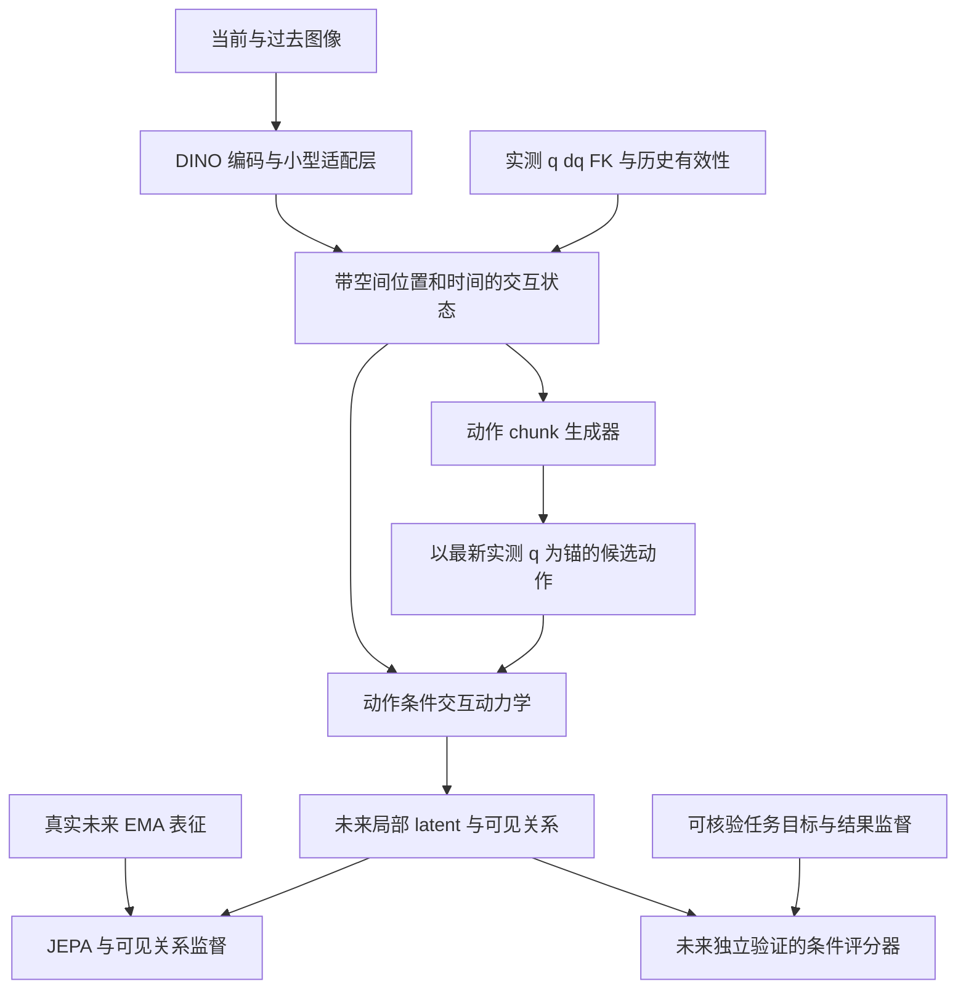

# 五组实验差异分析与模型结构优化建议

日期为 2026-11-10，时区 America/Sao_Paulo。依据五组 best checkpoint 的既有统一评估、逐 episode 重算、验证损失记录，以及隔离实验代码进行分析。本次没有启动训练、模型推理、GPU 作业或仿真，没有改变既有训练停止状态。物理时间戳同步按用户确认视为已解决。

## 1. 我的判断

**这轮没有得到同时、稳定改善动作模仿与物体预测的架构。最值得怀疑的是交互信息的表达和传递方式，以及动作学习与世界预测的训练关系。现有证据不足以把主要问题归结为编码器不够强，也不足以否定历史、局部视觉或 JEPA。**

五组更准确的描述是四次逐步增量。它们共享编码器、动作生成器、空间预测方式、监督目标与数据，改动集中于 reader 共享和额外上下文 token。后三组在共享 reader 基础上累加，缺少原版直接加历史、原版直接加局部视觉等组合，不能当成五条独立架构路线。

两个优先判断如下。

1. **对世界模型，首先改信息路由与交互状态。** 当前空间位置主要读取动作前缀，缺少预测器内部跨位置的视觉信息交换。局部与历史特征经过压缩后间接注入，未充分检验手—瓶关系、对应和运输。
2. **对策略，首先独立检验动作头及其共享梯度。** 后期总验证损失恶化主要来自 flow 项。动作头没有读取预测后果，因此动作改善与世界模型改善不是同一个问题，不能靠一条 total loss 排序解决。

这些是优先级判断，不是已完成的因果证明。需要在修好评价和 reader 对照后，以小规模单变量实验验证。

## 2. 五组结果并不等价，但增量证据较弱

|组|结构变化|最佳 epoch|动作 RMSE，rad，越低越好|h32 moving 瓶 IoU，越高越好|h32 static 瓶 IoU|
|---|---|---:|---:|---:|---:|
|1 原版|四组 reader，保留历史调用语义|23|0.13736|0.52748|0.82207|
|2 共享|合并 reader|23|0.13881|0.48456|0.81565|
|3 本体历史|组 2 加过去 8、15 帧 q/dq|21|0.13619|0.50408|0.83891|
|4 局部视觉|组 3 加两个当前手部 ROI 均值 token|23|0.13440|0.50750|0.82593|
|5 视觉历史|组 4 加过去两帧的 3×5 池化 token|23|0.13303|0.50085|0.80602|

以上物体指标为 direct 分支。所有组使用同一批 128 个窗口、16 个内部留出 episode，动作采样固定同窗噪声、K=1、10 步 Euler。训练 seed 只有 47。本轮实际训练为原 fit 内部的 64 个 episode，其余 16 个用于内部留出。

|动作比较，前组减后组|差值 rad|95% episode bootstrap 区间|改善的 episode 数|
|---|---:|---|---:|
|2 − 1|+0.001456|[+0.000217, +0.002866]|6/16|
|3 − 2|−0.002621|[−0.007766, +0.002895]|9/16|
|4 − 3|−0.001788|[−0.007404, +0.003536]|9/16|
|5 − 4|−0.001374|[−0.003523, +0.000674]|9/16|
|5 − 1|−0.004326|[−0.008263, −0.000151]|10/16|

实验 5 相对原版约改善 3.15%，其逐指标区间勉强未跨零。逐一删除任一 episode 后，动作均值差仍为 −0.00556 至 −0.00339 rad，所以这一点估计不是单个离群 episode 造成的。但它没有覆盖重训随机性，也没有消除模型选择影响。

实验 5 的 h32 moving IoU 相对原版下降 0.02663，原评估区间为 [−0.05525, −0.00239]。因此不能宣称组合模型整体胜出。后三次相邻动作比较的区间均跨零，也不能将组合收益单独归因于视觉历史。

必须保留三个统计边界。

- 区间跨零只表示尚未确认差异，不能证明等价。本轮没有预先定义等价边界并实施等价检验。
- 这些区间是多项比较中的逐指标区间，未经多重比较校正。不能把几项刚好未跨零的结果当成稳定选型结论。
- 同一 16 个 episode 已用于选择 checkpoint。本次 128 窗评估与选型时 64 窗不完全相同，但 episode 未独立，仍是探索性内部验证。

训练结束步数不一致，影响搜索机会和最终状态可比性。不过各组 best 都在 epoch 21–23，均早于停止位置，因此“某组根本没训练到同一阶段”不太像本轮主要解释。它仍不能排除较早停止组日后出现第二个更好点。

## 3. 五组为什么容易接近

### 3.1 新增输入不一定提供新的可用信息

本体历史只加 t−8、t−15 两个 q/dq token。当前 q、dq、FK 已能表征一部分运动与任务阶段，额外历史可能主要补充较慢的阶段变化。以前 X1 低容量探针提示本体历史有信息，但并未证明该信息能被当前大模型以当前注入方式有效使用。

局部视觉从当前 960 个 DINO token 中，对两只手的 FK ROI 分别取均值。它重排了已有信息，没有提高输入分辨率，没有保留 ROI 内部布局，也没有单独提供瓶实例位置。两个均值可能帮助识别手部外观，却很难显式表示“哪根手指在瓶的哪侧、手与瓶之间有多大间隙”。因此，这轮不能否定保留空间结构的局部视觉。

视觉历史仅有 t−8、t−15，分别约为过去 0.53 秒与 1 秒。每帧由单帧 DINO 编码，再压成 3×5 个 token，一个池化单元约对应存储图像的 64×64 像素。它没有直接提供最近一两帧的小位移，也没有显式跨帧对应或同一物体追踪。它测试的是稀疏、强池化的历史输入，不能代表视频运动编码器的效果。

更细的历史可能有用，但目前“模型忽略了新增输入”和“输入本身增量有限”尚未被区分。注意力权重不能单独回答这个问题，需要历史替换、同帧重复、删除局部 token 等输入干预。

### 3.2 空间预测结构是五组共同的限制

当前预测器的信息路径可简化为

```text
q/dq/FK + 新增历史/局部 token
                 ↓
         因果动作 token 序列
                 ↓ 被各空间 query 读取
当前各位置 DINO token → 对应位置未来 latent
```

`TemporalActionBlock` 让动作 token 读取 state memory。`SpatialReadBlock` 让当前视觉 query 读取动作 token，随后使用逐 token FFN。预测器内部没有视觉位置之间的自注意力，也没有让未来位置直接跨位置读取当前 dense visual memory。

这不会使物体运动在数学上不可表示。DINO token 已包含全图上下文，新加入的局部与历史图像也能经动作 memory 间接进入预测。但物体离开当前位置、出现在另一位置、被手遮挡、与另一物体交换相对位置等变化，需要靠现有压缩路径隐式恢复。**对只有 64 个训练 episode 的这轮实验，这种归纳偏置可能不利于交互泛化。**这是较强的结构假说，尚未通过替换模块证明。

最小的结构变化是让预测查询直接读取当前视觉 memory，并加入低成本局部空间混合。更进一步才是把手、瓶、箱及其关系变成紧凑动态状态。仅继续增加 state token 数量，没有直接解决这条信息路径。

rollout 还有一个共同约束。每段更新预测视觉 z，却继续使用最初的实测状态和历史 memory，动作序列按 4/4/8/16 步分段重新编码。前段交互信息主要需要由 z 传给后段。这不是把实测状态保持不变的实现错误，但提示可以单独维护预测的交互记忆与计划几何。它们必须明确标为预测量，不能冒充新的实测 q/dq，动作锚仍保持最新真实观测。

### 3.3 共享 reader 把语义修正与容量减少混在一起

原版按绝对 horizon 选 horizon embedding，却按调用列表中的局部索引选 reader。共享版消除了这个差异，同时把预测器参数从约 10.34M 降到 5.60M。它还改变了不同时距之间共享梯度的方式。

所以共享版较差，可能来自容量减少、不同时距互相干扰、原版训练对历史路由形成了适应，或这些因素组合。不能据此得出“语义一致性有害”。最干净的修复对照是保留四组 reader，按绝对 horizon 选择，再和当前共享实现比较。

原版与共享版逐 episode 动作 RMSE 相关系数为 0.9865，难例结构几乎相同。后三组对应相关系数约 0.77–0.84，说明历史确实可能改变了一部分 episode 的行为，只是尚未形成稳定总体优势。

### 3.4 总验证曲线主要在反映动作分支

|组|best 到末次验证 total 增量|其中 flow 增量|flow 增量 / total 增量|
|---|---:|---:|---:|
|1 原版|0.14439|0.13503|93.5%|
|3 本体历史|0.10799|0.09905|91.7%|
|4 局部视觉|0.26671|0.24502|91.9%|

五组最佳 checkpoint 的 flow 数值约占 total 的 63%–64%，各组最低 flow 验证值也恰好与 total 最佳点一致。世界模型 JEPA 项和预测掩码项的最低点并不总在同一 epoch。

这说明当前总曲线和 best checkpoint 规则主要围绕动作模仿泛化选点，不能用来判断每个世界模型分支的最佳训练阶段。它也解释了为什么五组都在相似 epoch 达到最佳。

实验 5 比原版 total 低 0.02174，其中 flow 降低 0.01473，JEPA 降低 0.00677，rollout 加权项降低 0.00302，IDM 和 mask 加权项反而升高。它与动作改善、物体指标不改善的现象相容。

**损失数值份额不等于梯度份额，更不等于梯度冲突证据。**当前未测各任务在同批次共享参数上的梯度夹角，也未做相同条件下的梯度隔离训练，因此“多任务冲突”仍是待验证解释。各模型的 EMA 表征不同，JEPA 从 0.04024 降到 0.03347 也不能直接翻译成物理预测提高 16.8%。

### 3.5 动作生成与世界模型的评价目标没有对齐

flow 训练对归一化动作计算速度场误差，时间权重为前 8 步各 4、随后 8 步各 2、最后 16 步各 1。因此前 8 步占一半训练权重，最后 16 步只占四分之一。

统一评估却对原始 rad 的 32×54 个数等权计算 RMSE，最后 16 步占一半元素。40 个手指维占 54 维的 74.1%，这只是维数占比，实际平方误差贡献还取决于各关节误差大小。

因此，当前单值可能掩盖前缀动作、双臂与手指之间的不同变化。需要分别报告 1–4、5–8、9–16、17–32 步和 A7/B7/L20/R20 的误差，并保留原整体指标。现有 JSONL 没有逐动作输出，无法只用它完成细分，也不能猜测收益具体落在哪部分。

更关键的是，五组 `propose()` 都只读取视觉和状态 memory，未使用 forecast。动作改善可直接来自历史输入和共享编码器，与预测后果是否更准确没有必然关系。当前五组没有检验候选评分或闭环成功。

### 3.6 数据与观测仍限定了可学习的后果

只有成功示教附近的动作，很难区分“动作造成结果”和“任务阶段预示结果”。当前 q、手形、瓶位置和进度高度相关时，模型可以利用这些相关性预测常见后续。IDM 存在并不自动消除这一问题，其全局池化图像输入加 q/步数同样可能利用阶段线索。

顶视单相机也不能总是确定瓶的高度、稳定抓持、隐藏接触或是否真正落入箱中。更细的时序有机会减少歧义，但没有证据保证完全恢复隐藏状态。标签与单视角的这些限制应体现在可见性和不确定性中。

这不等于所有收益都被数据上限锁死。它意味着结构优化应优先提取可观测的局部关系，并把“示教未来预测”和“分布外候选真实后果判断”分开验收。

## 4. 新的逐 episode 重算补充了什么

### 4.1 模型并非完全不利用动作

h32 moving 层中，使用真实示教动作的 direct 相对 hold-command 的瓶 IoU 增量依次为

|组|direct − hold-command|direct − copy|
|---|---:|---:|
|1|+0.09459|+0.14919|
|2|+0.06119|+0.10668|
|3|+0.08680|+0.12911|
|4|+0.09808|+0.13334|
|5|+0.09242|+0.12270|

新配对 bootstrap 中，direct−copy 五组区间均大于零，direct−hold 除共享版外均大于零。这支持示教动作对预测示教未来提供了可利用信息。

但 hold-command 没有对应的真实执行未来，因此上述比较不能验证 hold 情形的物理准确性。大幅改变命令有影响，也不证明能可靠分辨相距 0.04–0.05 rad 的候选。这里不能用“有动作敏感性”替代“有候选选择能力”。

### 4.2 长时距的静止保持仍有问题，但绝对 IoU 混合了多类误差

|组|h32 static direct|同层 copy|direct − copy|95% episode 区间|
|---|---:|---:|---:|---|
|1|0.82207|0.86187|−0.03981|[−0.07836, −0.00523]|
|2|0.81565|0.85374|−0.03809|[−0.05897, −0.01934]|
|3|0.83891|0.85782|−0.01891|[−0.04631, +0.00741]|
|4|0.82593|0.84570|−0.01977|[−0.03704, −0.00130]|
|5|0.80602|0.84420|−0.03819|[−0.06339, −0.01471]|

这里 copy 是当前 latent 经本模型 decoder 解码，再与未来伪掩码比较，不是复制真实当前掩码。static 只要求当前到未来的瓶并集质心净位移小于 2 px，不能保证中间全程静止，也可能掩盖多个瓶的相反运动。

实验 5 的绝对 static IoU 比原版低约 0.01605，其 copy 也低约 0.01767。因此两者相对自身 copy 的损失接近，不能把实验 5 的静态绝对差全部归因于动力学更差。

下一次评价需要加入当前帧重建、真实未来 EMA latent 的 decoder oracle，以及预测未来的解码指标。真实未来 oracle 不是严格不可超越的数学上界，但能作为表示和解码参考。比较 oracle−prediction 的差距，才更有助于定位感知、解码和动力学各自的限制。

新增区间使用 episode 配对重采样 10,000 次、seed 4712。上一份跨组区间使用 seed 4711，两者均为逐指标探索性区间。

## 5. 建议的目标架构

保留 JEPA 思路，优先把模型改成明确的观测融合、交互动力学和动作生成三部分。下图是设计建议，未实现或验证。



### 5.1 先建立容量不变的 reader 修正版

保留四组 reader，统一用绝对 horizon 路由。直接预测、单 horizon 调用、horizon 重排和 rollout 的索引定义必须一致。对同一终点，direct 与 rollout 仍可以因输入状态及组合误差而不同，不能要求二者天然数值相等。

共享 backbone 加小型 horizon adapter 可作为后续效率方案，先不要同时减少容量、改变路由和增加历史。当前代码已经输出 `ctx.z + delta`，`delta` 配置主要改变末层零初始化，不能再把“加残差”作为新的核心结构改进。

### 5.2 让当前视觉直接参与动作条件的空间预测

最小改法是在现有预测 reader 中增加当前视觉 memory 的跨位置读取，先采用稀疏局部窗口或少量视觉汇聚 token 控制开销。未来 query 同时读取视觉、动作和实测状态，避免视觉交互全部绕经动作 token。

后续可引入约 32–64 个交互 token 作为起始试验规模。覆盖左右手、目标瓶及候选瓶、箱边界与少量全局背景，保留二维位置、相对位置、可见性和身份置信度。这个数量是预算建议，不是已知最优值。不要把所有物体压成一个瓶并集状态。

对象位置只能来自当前与过去观测。未来掩码可以作为训练监督，不能在候选推演时提供未来 ROI。暂时无法可靠区分瓶实例时，保留多个局部候选及不确定性，比强行赋予固定身份更稳妥。

先在现有 DINO 特征上使用 2×2 或 3×3 ROI 小网格，增加坐标编码，再考虑重新裁图编码。这样能把“空间布局”和“输入保真度”的贡献分开。放大存储图像本身不会恢复缺失的像素细节。

### 5.3 用小型因果时序模块形成当前交互状态

将近帧与远帧结合，例如从 `{0,1,2,4,8,15}` 中固定一组历史采样。先保留同一目标附近的局部布局，通过一到两层时间 attention 或小型 GRU 融合，明确输入时间差、历史有效性与遮挡。

它要回答的是“同一瓶相对手如何变化”，而不只是提供两个过去图像的粗摘要。世界模型和策略可以分别读取融合后的状态。ROI 错位与对象追踪错误是主要风险，所以应先证明当前局部定位和真实历史读出有增量，再扩大时序模型。

### 5.4 分开可预测的机器人几何与不确定的物体运动

URDF/FK 可以提供候选关节命令对应的计划手部几何，物体分支重点预测手—瓶关系、瓶位移、遮挡和释放可见代理。命令 FK 不是实际执行轨迹，不能假设无控制误差，更不能用它宣称已知接触力或实际抓稳。

物体分支可尝试内容保持与运动更新分解，或局部特征运输加小残差。静态区域通过有证据的更新门减少无谓变化，动态区域允许位置迁移和可见性变化。真实静止监督只能在可信、可见的观测区间使用，不能把 hold-command 无条件标为物体静止，重力、惯性和已有接触都可能产生运动。

这比再次改变 latent 的残差写法更有实质差别，但对象匹配和门控塌缩是风险。必须同时检查运动收益与静止保持，避免模型通过少动取得表面改善。

### 5.5 动作头先做一个便宜而明确的结构对照

当前 flow 对整个 32 步噪声动作块施加三角 causal mask。生成时 32 个噪声位置同时存在，因此可以只让 flow 内动作位置使用双向注意力，测试早期动作与后半段计划能否更好协调。

这不需要未来观测。训练和推理仍只能使用截至当前的观测。世界预测器的动作前缀因果约束必须保留，不能把这个改动扩展到依赖未来真值的预测路径。

这一改动不增加主干参数，适合作为单变量实验。不能预先保证它有效。之后才考虑把动作表示分为 A7/B7/L20/R20 的耦合 token，保留跨臂、跨手注意力，避免四个独立头破坏协调。所有输出保持 canonical 顺序、rad 单位与最新实测 q 锚定。

### 5.6 给动作与世界模型明确的梯度边界

首先利用已有 `flow_memory_detach` 做诊断，对比 flow 梯度回传共享编码器和状态模块的效果。它会同时改变这些条件模块的更新，必须完整记录范围，不能简单称作只冻结视觉。

若隔离后物体预测改善而动作不退化，才值得进一步拆成共享低层视觉加独立 policy/world adapter。相应 EMA 目标应跟随 world 表征路径，减少策略目标改变世界模型表征的影响。若动作明显退化而世界模型无收益，则不支持该拆分。

以前 E63 的冻结编码器结果较差，说明不能直接认为“全部冻结必定更好”。小型适配层、梯度隔离和全编码器冻结是不同干预，需要分别验证。

### 5.7 候选评分保留为后续独立问题

现阶段不建议让同一未校准潜变量距离承担任务价值，再用它反向优化策略。评分器应显式依赖当前状态、候选引起的未来关系变化、任务目标及可见性，避免线性拼接时当前上下文在成对相减中被抵消。

需要比较动作/状态 only、预测后果 only、两者结合。如果预测后果没有额外选择收益，就不能把评分收益归功于世界模型。已有 E65 特权教师的收益说明候选池存在模仿误差选择空间，但真实未来和未来掩码不能作为部署输入。

仍须有可信目标或结果监督。补充示教事件标签也不能提供未执行候选的真实后果。仅靠 93 条示教，期望模型可靠判断任意分布外 54D 动作，大概率超出当前证据和数据覆盖。语言标签也不能自动补上这个缺口。

## 6. 损失函数应怎样调整

当前问题不是某个系数已经被证实“设错”，而是多个损失混在一个选型标量里，难以对应用户关心的行为。

|部分|建议|原因与限制|
|---|---|---|
|JEPA|保留，并尝试全局低权重加局部交互预测|关注可观测对象关系，同时避免只拟合小 ROI 而丢失上下文|
|RGB/mask|暂保留，先补真实 latent 解码参考|当前还不能区分表示、解码和动力学瓶颈，不宜同时删除所有约束|
|horizon 权重|单独报告 h4/h8/h16/h32，再决定是否调整|当前 `.35/.30/.20/.15` 偏短期，长时距是候选评估的重要部分|
|flow|同时监控标准化训练误差、实际采样前缀误差及整体误差|速度场拟合并不等于 Euler 采样后的 rad RMSE|
|IDM|补 q-only、图像对替换等诊断，再决定简化或重定位|IDM loss 本身不能证明瓶子接触因果被学到|
|variance|保留必要稳定作用，补有效秩和条件敏感性检查|当前在单样本 token 维度估计方差，空间差异即可满足约束|
|多任务梯度|先看同批次梯度范数与夹角，配合 detach 对照|只调系数无法直接定位是否存在负迁移|
|静态/动态约束|在可见、身份可靠的片段分开验证|不能把净位移小、未观测或遮挡统一当成真实静止|

不建议现在同时改变全部权重。先用旧权重比较结构，确认结构改变有效后再校准损失。方差惩罚变小表示更少违反该方差下限，不能直接解释为表征塌缩。

checkpoint 应至少保存固定 epoch、动作指标最佳、世界模型指标最佳的独立记录。最终集成方案需要动作与世界指标共同达标，不能把两个不同 checkpoint 的各自最优数字拼成一个模型的性能。

## 7. 后续实验顺序

下面是下一轮建议，尚未启动。先完成评价补充，再按预算从三个结构实验中推进。不要直接重开五组长训练。

### 前置评价 Q0，复用现有 best，无需训练

**问题**是模型用了哪些条件，以及当前指标是否掩盖关键差异。

- 补动作的时间段和四关节组 RMSE，额外报告前 4/8 步、尾段与每集分布。用多个固定采样噪声报告 K=1 的期望误差与方差，best-of-K 只能作为 oracle 参考单列。
- 补当前重建、真实未来 latent 解码、direct、rollout 与 copy，分开感知/解码参考和预测差距。
- 对历史做同帧重复、时间置乱、匹配状态的跨窗替换，对局部 token 做删除。记录输出变化及误差变化，避免只看 attention。
- 对世界预测做正确动作、hold-command 和受限动作替换的敏感性诊断。未执行动作不具有真实后果标签，不作反事实准确率声明。

**判读**为，真实未来解码已差则优先修观测表示或读出，解码好而预测差则优先动力学，历史干预几乎无影响则优先信息路由。零化或错配输入本身可能分布外，因此单项负结果不能直接宣称信息无用。

这些需要额外前向推理。现有 JSONL 只支持本报告的逐窗和逐 episode 统计，本次没有执行 Q0 推理。

### 实验 R1，容量不变地修复 reader 语义

**问题**是之前共享版的下降主要与容量/共享相关，还是与 reader 路由改变相关。

**干预**为保留原四 reader，仅改为按绝对 horizon 路由。原版和共享版作为既有参照，新训练的主对照要统一 seed、数据顺序、预算与参数初始化。先做调用一致性、前缀因果和 rollout 锚点结构检查。

**判据**为动作非劣、h16/h32 moving 不下降、static 相对 copy 不恶化。报告固定 epoch 和事先规定的选型点。reader 专用修正版恢复准确性且保持调用一致，才支持采用它作为后续结构基线。

**风险**是容量相同仍未消除梯度分配变化。该实验能排除简单容量解释的一部分，不能给出唯一因果分解。

### 实验 P1，只改变 flow 的动作注意力方向

**问题**是三角 mask 是否限制了整块动作的协调生成。

**干预**为在修正版 reader 基线上，只把 flow 内动作 self-attention 改成双向，其他条件、参数规模、损失、采样步数和训练预算相同。世界模型动作前缀和观测因果保持原约束。

**判据**为前 4/8 步与整体动作误差、四关节组误差共同改善或非劣，同时监控动作变化的平滑性和世界预测。先用一对 seed 47 作机制筛查，有实质信号后再补另外两个训练 seed。单 seed 无信号就不为完整矩阵投入长训练。

**风险**是原有 mask 实际提供了有益正则，解除后反而过拟合。即使动作改善，也不能归因于世界模型推演。

Q0 或梯度诊断若强烈指向共享表征干扰，可用单变量 `flow_memory_detach` 对照替代 P1，不要在同一组同时改 mask 和梯度路线。

### 实验 W1，让预测器直接读取有布局的交互视觉

**问题**是空间信息路由是否比单纯增加 token 更重要。

**最小干预**为保留 backbone、当前历史长度、现有 dense 视觉特征与损失，只在预测 reader 增加对这些视觉特征的直接读取。提供参数量接近的普通 FFN/reader 扩容对照，区分读取路径与单纯增加参数。

先检验读取路径。有效后，另做有布局的手/瓶 ROI 小网格及坐标表示，再单独增加近帧因果时序融合。瓶 ROI 必须预先固定观测来源，使用人工真值的定位诊断要显式标为 oracle。不把读取路径、局部表示、新时序、换编码器和新损失一次全部叠加。

**判据**为 h16/h32 moving 的预测增量提高，static 相对 copy 保持，真实未来解码参考与预测之间的差距缩小，动作非劣。需要观察到预测对可信局部输入及动作的合理敏感性。

**风险**是局部定位/身份错误成为新瓶颈，或者新视觉路径让模型更容易走当前外观捷径。必须使用只依赖过去的 ROI，并检查动作依赖没有被削弱。

### 通用预算与验收建议

初筛采用统一预设更新预算，重点覆盖已有最佳点附近，不能把当前在约 23 epoch 最佳硬编码为所有新架构的真最佳。可预设约 30–35 epoch 的筛查上限与固定 patience，若仍持续改善再按预注册规则延长。确认性对照建议至少三个训练 seed，但三个 seed 也不能提供充分的真实机器人可靠性证明。

若需要立即设立工程筛查门槛，可在运行前固定例如动作前缀误差改善至少 3%、整体动作非劣界 2%，或 moving IoU 提高至少 0.03、static 非劣界 0.01。这些数值只是建议的投入决策阈值，未经物理容差校准，不能追认本轮结果已通过或据此宣称可部署。

先固定主要比较与指标，避免看完结果再选择最有利 horizon。按 episode 聚合，并分别报告训练 seed 差异与 episode 不确定性。历史用过的 dev/test 不能因改名而重新成为独立确认集，多组划分只能改善内部稳健性判断。最终需要未参与本轮架构选择的新 episode 或明确隔离的外部验证。

## 8. 预训练、语言与更大编码器的优先级

这轮证据不支持把更换 DINOv3/SAM/V-JEPA 放在最前面。实验 4 没有检验高保真裁图，实验 5 没有检验视频预训练，所以也不能用本轮否定它们。应先定位瓶颈，再决定是否更换输入表征。

V-JEPA 2-AC 使用冻结预训练表征，另行训练动作条件预测器，使用约 62 小时机器人交互数据，并在闭环中规划。它支持分阶段学习的设计思路，不能保证视频先验自动补足本项目 54D 接触动作的覆盖。[V-JEPA 2 原论文](https://arxiv.org/html/2506.09985v1)

ACT 在约 50 条示教的任务上展示了动作 chunk 模仿，但输入包含四路相机及腕部视角。这支持保留干净的动作模仿对照，不能把其闭环成绩外推到本项目顶视灵巧手条件。[ACT 官方项目页](https://tonyzhaozh.github.io/aloha/)

LeWorldModel 使用紧凑潜变量和简单预测目标，说明值得检验状态压缩与目标简化。其控制任务与本项目不同，也不能据此认定单一全局 token 足以表达双手、多瓶和遮挡关系。[LeWorldModel 官方项目页](https://le-wm.github.io/)

单任务重复语言指令通常不会提供当前欠缺的接触或候选后果监督。若进一步标注，优先对象身份、可见性、关系变化与结果区间，并保留 unknown。当前项目规则禁止引入 VLM，本建议不引入任何 VLM，也不改变活动策略基线。

## 9. 证据、限制与落地边界

五组主要来源是远端项目 `runs/arch_reader_training_20261110_v1/` 的既有产物。

- `FIVE_BEST_EVALUATION_RESULTS.json` 与各组 `best_evaluation.jsonl` 提供统一评估。
- `STOPPED_EXPERIMENTS_RESULTS.json` 提供 best、停止位置和完整验证项。
- `e47_model.py` 第 170–262 行提供动作和空间 reader，317–327 行提供 flow mask，392–424 行提供 rollout 与 propose。
- `e47_model_history.py` 第 22–33、53–87 行提供历史采样、ROI 平均、视觉池化和注入位置。
- `e47_train.py` 第 245–348 行提供多任务损失，特别是 316–326 行的 flow 权重与 328–336 行的 variance 定义。
- `ablation_eval.py` 第 49–69 行提供目标表征、动作 RMSE 与现有解码分支。

本地新增 `arch_five_group_audit_20261110/independent_episode_audit.json` 保存本次独立重算，目录中另保存五组原逐窗评估快照。原始实验产物和既有报告保留。

本报告没有证明梯度冲突、对象 token 必然有效、当前 latent 已塌缩，或历史必然被忽略。没有新的候选真实执行数据，也没有闭环成功率。

以上 JEPA 改动均作为隔离研究建议。依项目当前规则，活动物体 planner 的首个动作条件后果模型仍为 MuJoCo，不把这些历史 latent dynamics 自动接回活动规划链路。当前训练保持停止，后续实施需作为新的实验工作推进。
