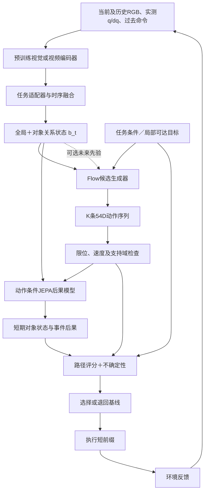

# JEPA 世界动作模型：架构优化建议与后续实验验证计划

日期：2026-11-09（America/Sao_Paulo）  
对象：天机双臂＋Wuji 灵巧手，顶视相机，54 维关节动作，15 Hz，抓瓶放箱  
前提：接受 JEPA 架构的合理性，保留流匹配动作生成；研究如何把它训练为可用的端到端系统。

本报告基于本会话已完成的 TeX、代码、实验报告和原始文献只读审阅。除新建本报告外，不修改已有文件，不启动训练、推理评估、仿真或 GPU 作业，不操作他人进程。本文所有实验和预算均为建议，未执行，也不表示已获准执行。

## 1. 核心判断与证据边界

**应继续利用大规模预训练，并将系统组织为“时序状态估计—候选生成—动作条件后果预测—任务评价—保守选择—短前缀执行—再观测”。当前最需要补齐的是状态信息、动作域适配和评价依据，不是简单增加编码器规模或语言标注量。**

目前 E47 是带未来预测辅助学习的模仿策略。它有动作条件世界模型，但 `propose()` 只使用当前视觉和状态、采样一个候选，不通过后果排序。E64 让后果梯度影响了动作头，却没有学出显式候选选择器。将这些能力分清，并不否定 JEPA；它决定下一步应补哪一段。

### 1.1 本报告直接回答的六个问题

| 问题 | 判断 | 优先行动 |
|---|---|---|
| 是否引入大规模语料预训练权重 | 是；DINOv2 已是大规模预训练。视频、语言、动作交互预训练迁移的是不同能力 | 优先验证因果视频表征及操作视频预测预训练，不把语言规模等同于接触动力学能力 |
| 是否需要高保真、DINOv3、SAM | 原始细节值得保留；新 backbone 不必然带来动作收益；SAM 更适合辅助定位和监督 | 全局上下文＋原图局部裁剪＋时序输入；在公平适配条件下比较编码器 |
| 端到端链路是否合理 | 合理，但候选前的未来先验与候选后的反事实推演必须区分 | 建立清晰接口、隔离训练目标，并最终执行短前缀后重观测 |
| 如何推演和评价候选 | 从相同因果状态出发，预测整段局部后果，结合任务关系、可行性与不确定性评分 | 优先短时、对象相关、可拒绝判断的选择器 |
| 是否增加 language／细粒度标签 | 单任务重复指令信息量低；细粒度事实更优先 | 校准时间、对象身份、可见性、事件边界和已有失败恢复；文字作为表达接口 |
| 当前损失是否合理 | JEPA＋flow＋辅助约束合理，但不构成完整的候选价值学习 | 保留基础损失，补对象／事件锚定；按梯度与留出结果选权重，不凭系数大小判断 |

### 1.2 已核实事实与不能过度解释的结论

- E47 主干是 DINOv2，不是已经验证有效的 V-JEPA。采用 JEPA 目标与采用 V-JEPA 预训练权重不同。
- TeX 中 E64 的“进行中”已过期。`E64_REPORT.md` 记录 P0→P4 关节 RMSE 为 0.1182→0.1224 rad，约恶化 3.59%；独立 seed48 世界模型下真实未来匹配也更差，但终点进度代理改善 0.0013，95% CI [0.0006, 0.0022]。无等步数纯模仿继续训练控制，不能把差异归因于想象项。
- E47 的 fit/test 运动瓶子预测落差支持泛化不足。静止瓶子的 common/native 网格结论并不完全相同，IoU 下降还混入边界、面积和阈值因素，不能全称为物理漂移。
- E63 支持“特定冻结编码器＋浅适配方案没有带来动作收益”，不证明高保真无用、DINOv3/SAM 内在较差或冻结表征必然失败。TeX 的微调参照与各臂结果用于方向判断；严格因果比较仍需对齐训练流程。
- E55 的“预言机”是候选预测到**示教真实未来**的距离，不是每个候选实际执行后的质量真值；部分数字来自 E33 历史分支。不能把约 0.53 当成 E47 的真实任务排序上限。
- 93 episode 约 27,281 帧，相当于约 30.3 分钟；大量帧／窗口相关。数据规模不能按独立接触实验数量理解。
- 项目当前 `AGENTS.md` 中 active baseline 与 TeX 的历史 JEPA 主线不同。本报告按用户指定的 JEPA 前提给出设计建议，不改变当前工程主线，不引入或部署任何新模型。

## 2. 文献对设计的实际启示

这里选取有直接架构启示的代表性原始来源，不做排行榜；2026 年近期预印本属于新证据，不视为已经广泛复现的定论。

| 来源 | 可以借鉴的内容 | 不应外推的内容 |
|---|---|---|
| [RT-2](https://arxiv.org/html/2307.15818v1) | 网页视觉语言预训练可改善语义和视觉迁移；机器人轨迹负责动作对齐 | 原论文明确区分这些收益与新运动技能；纯网页经验不能补齐任意机器人技能 |
| [OpenVLA](https://arxiv.org/html/2406.09246v3) | 大规模视觉语言基础＋机器人训练；其消融支持视觉任务适配的重要性 | 其更高分辨率未提升效果，不代表本任务的小物体细节不重要；不能直接移植单臂接口 |
| [π0.5](https://www.pi.website/blog/pi05) | 多环境、跨机器人、网页多模态及子任务语义共同支持泛化 | 不能把新场景泛化单独归功于文本规模 |
| [GR00T N1](https://arxiv.org/html/2503.14734v2) | 预训练视觉语言模块与 flow 动作模块可以组合，并保留 embodiment-specific 状态／动作接口 | 不是换编码器后就自然获得本体控制能力 |
| [DINO-WM](https://proceedings.mlr.press/v267/zhou25t.html) | 空间潜变量、动作条件预测与目标规划可以不依赖像素重建 | 零样本目标求解不等于没有相关动力学数据，也不保证当前 54D 接触任务可迁移 |
| [V-JEPA 2](https://arxiv.org/abs/2506.09985) | 大规模视频先验与机器人动作条件后训练分开；规划需要目标与反馈 | 无人工任务标签不等于没有动作／状态记录；被动视频预训练不等于已学会 Tianji 动作后果 |
| [V-JEPA 2.1](https://arxiv.org/abs/2603.14482) | 更强调稠密空间结构与时间一致性，值得作为视频编码器候选 | 外部 benchmark 表现不能证明在顶视透明瓶、双臂灵巧手上的收益 |
| [V-JEPA Policy](https://arxiv.org/html/2609.37250v2) | 冻结预测视觉表征，联合训练未来预测器与 flow，并利用操作视频预训练预测器 | 未来辅助策略不等于逐候选动作推演与显式排序；近期论文结果需本地验证 |
| [The Planning Limits of Latent World Models](https://arxiv.org/abs/2609.39235) | 短想象与遥远目标不匹配会损害排序；局部目标和反馈值得重视 | 论文有环境等额外条件，其数值不能直接迁移到当前纯开环条件 |
| [π0.7](https://www.pi.website/blog/pi07) | 更丰富的任务、子步骤、质量与控制条件可帮助组织多样行为数据 | 给 93 条同任务示教补长文本，不能获得同等数据覆盖 |

**迁移优先级：视觉／视频通用先验 → 操作视频经验 → 本机器人动作条件适配。** 大型语言主干主要解决任务语义、对象选择和技能组合；在当前固定任务中，不应优先于时间对齐、历史状态和对象交互建模。

## 3. 完整目标架构

### 3.1 总体结构

图中环境反馈只代表未来最终验证／部署需要的闭环接口，本次未运行，当前数据也不能实现真实反馈。MuJoCo 不进入训练、候选评分或标签生成。

### 3.2 输入合同与因果状态

建议输入：

\[
b_t=E_\phi(I_{t-L:t},q_{t-L:t},a_{t-L:t-1},v_{t-L:t}),
\]

其中 \(v\) 表示图像、关节、对象及时间戳的有效性标记。先用约 0.5–1 秒的短历史做受控比较，不预设越长越好。

- 保持关节顺序 `arm A 7 + arm B 7 + left hand 20 + right hand 20`，角度为 rad。
- q/dq 的统计只由训练数据拟合；明确 dq 是 rad/frame 还是 rad/s，不混用。
- 动作 chunk 始终锚定最新实测 q。候选内部的预测状态独立标记，不冒充观测。
- 记录相机时间、命令时间、实测状态时间及相应有效性。用 fit 数据确定时延模型，锁定后再评估。
- 若有执行队列，将尚未执行的命令作为已知条件；不能假设新候选从当前画面瞬时生效。
- 视频编码器必须只读取截至 t 的观测。不能先双向编码含未来的完整视频，再截取当前 token。
- 未来 EMA 目标可作为监督，但目标构造应明确时间范围；跨候选、跨模型评价需要固定且一致的参考坐标。

**单帧顶视不足以确定所有接触状态。** 历史能改善速度、遮挡和共同运动估计，不能凭空恢复被遮挡的高度、受力或真实抓持稳定性。

### 3.3 视觉表征：全局上下文＋真实局部细节

保留原始图像作为数据源，不把已有 320×192 帧的插值放大称为新增细节。默认采用：

1. 全局视觉 token：场景布局、双手、瓶、箱及相互位置。
2. 局部视觉 token：从原始帧提取手—瓶交互区域；保留全图坐标、裁剪尺度和有效性。
3. 对象／关系 token：左右手、目标瓶、箱子及可见性、相对位置、运动信息。
4. 时间融合：聚合历史对象状态与全局信息，建立当前状态估计。

四类对象不强制各压成单个 token；瓶或手需要多个 token 才能保留形状及局部交互。token 数量是待测计算参数，不以 960 或任意更大数量为目标。

SAM 优先用于离线辅助掩码、对象跟踪与置信度；若成为在线模块，必须把耗时及错误纳入系统评估。ROI 从当前／历史信息产生，不能从未来 mask 生成推理裁剪。定位失败时回退全局通路，不丢弃对象或整帧。

编码器短名单保留当前微调 DINOv2；先验证冻结 DINOv2＋有容量的时序／空间适配器，再与 V-JEPA 2.1 比较。只有原图局部细节实验通过或有明确空间需求时，再加入 DINOv3。SAM 特征融合不作为默认必选项。

### 3.4 动作条件 JEPA 后果模型

\[
\hat Z_{t+\mathcal H}^{(k)}=F_\theta(b_t,A^{(k)},\Delta t),
\qquad A^{(k)}\in\mathbb R^{32\times54}.
\]

建议保留现有多时距 JEPA 与 EMA 目标，同时明确三个子功能：

- **机器人执行状态**：命令、实测 q、时延和 FK 条件下的预期运动；FK 不是实际执行真值。
- **对象响应**：瓶的可见位移、共同运动、释放与持续性等。
- **关系更新**：左右手—瓶—箱之间的信息交换；预测阶段应允许对象间或局部视觉 token 间的消息传递。

先建立共享转移语义、直接多时距预测及少量递归步的清晰对照，不立即把 32 步逐帧递归全部展开。长想象必须与实际训练覆盖相匹配。

可增加少量预测头或独立 seed 模型估计分歧；该分歧仅是模型不确定性的代理。低分歧不等于分布外可靠。对遮挡后的多种可能结果，可先表达可见性／置信区间，不必立刻引入大规模随机视频生成器。

当前实现需先澄清：`OutcomePredictor.forward()` 按 horizon 选择 embedding，却按调用中的局部索引选择 reader；direct 多 horizon 使用不同 reader，rollout 单 horizon 总使用 reader 0。若改变实现，应视为独立代码版本，不能直接把新旧差异归因于架构组件。

### 3.5 Flow 候选生成器

\[
A^{(k)}\sim\pi_\psi(\cdot\mid b_t,g),\qquad k=1,\dots,K.
\]

- 保留 32×54 flow matching、最新实测 q 锚定以及训练集统计归一化。
- 首轮候选数建议限定 K=4 或 8；以实际时延决定，不预设越多越好。
- 多样性评估分别报告双臂、双手、腕部位姿轨迹、抓放时序与手物相对关系。全关节平均 RMS 只作辅助。
- 不以白噪声扰动幅度直接定义质量；优先观察 flow 本身的候选，再考虑受支持的时序／姿态变化。
- 保留单样本与 medoid 作为选择基线。medoid 是候选集中代表样本，不对不同抓取模式做动作平均。
- 候选经约束处理后，如动作发生改变，必须推演改变后的动作，不能用改变前的后果得分执行改变后的动作。

候选前的未来先验是可选的策略辅助；它回答“在该任务下可能／期望发生什么”，不代替给定候选后的后果推演。若接入，使用空间或中间层信息，并通过干预验证动作头是否使用它；不再只添加一个可能冗余的终点 token。

### 3.6 内部评价器与选择

建议评分结构：

\[
S_k=\sum_{h\in\mathcal H}w_h r_\eta(\hat b_h^{(k)},g)
+\beta V_\eta(\hat b_H^{(k)},g)
-\lambda C(A^{(k)})-\mu U_k.
\]

- \(r_\eta\)：对象关系与短期可观察事件收益。
- \(V_\eta\)：超出想象窗口的剩余价值；当前没有可信监督时设 \(\beta=0\)，不能拿未校准的阶段分数冒充价值。
- \(C\)：关节限位、速度、异常变化等代价或不可行判定；URDF 只能支持有可靠模型的约束。
- \(U_k\)：预测残差校准、支持域距离或模型分歧等警告指标；不是失败概率。

任务评价器可在潜变量上工作，不需要生成语言或完整 RGB。先在真实观测潜变量上学可解释事件，再检验在预测潜变量上的可用性；初期不让策略和预测器通过任意改变评价表征来提高自身得分。

局部目标从 fit 数据的真实事件定义／目标状态获得，不使用评估 episode 的未来。目标应在当前可预测时距内有意义。避免“h32 一定更像整段末帧”或“所有成功轨迹的距离必须单调下降”的要求。

不确定或评分差不足时，返回预先定义的基线候选／拒绝模型择优，而不是制造一个置信满满的第一名。退回基线仅是性能保护，不等于安全保证。

候选选择最后用离散 argmax 是合理的。若采用 softmax 权重作训练代理，也不能在部署时随意平均互不兼容的动作模式。端到端部署不要求全部模块同时自举训练。

### 3.7 执行与反馈

候选可预测较长 chunk，实际只执行较短前缀，然后用新实测状态更新。前缀长度应由时延、系统推理耗时与动作连续性决定，不能直接用 15 Hz 数据频率推定实时控制能力。

长时想象、动作采样、评分、图像处理、通信等都要计入 p50/p95 时延。若规划慢于控制周期，可明确高层重规划与底层执行频率，但不能把旧图像反复使用称为新观测。

## 4. 标注与数据扩展建议

### 4.1 优先标什么

| 优先级 | 数据字段 | 推荐表达 | 对应训练作用 |
|---|---|---|---|
| P0 | 图像／命令／实测 q 时间戳与有效性 | 原始时间、偏移估计、缺失标记 | 正确动力学与 IDM 监督 |
| P0 | 目标对象身份与手侧 | 跨帧稳定 ID，歧义标记 | 避免对象切换造成伪运动 |
| P0 | 可见性／遮挡／标签置信度 | visible / occluded / unknown | 屏蔽不可判定监督，区分消失与遮挡 |
| P1 | 接近、共同运动、离手、稳定停留事件 | 时间区间与不确定边界 | 局部目标、事件预测及评分 |
| P1 | 已有失败、滑落、重试、恢复与末态 | 可观察结果＋证据片段 | 后果质量与恢复覆盖 |
| P2 | 任务／子任务语言 | 简短规范描述，与对象 ID 对应 | 多任务条件与跨数据对齐 |

顶视二维重叠不标成三维接触或入箱成功；手闭合不标成抓稳。只见视觉证据时命名为“共同运动”“离手后稳定可见”等，不伪造受力、接触或物理成功标签。

初始标注可在 fit 的 80 episode 中每集抽取 4–6 个转变片段，约 320–480 个片段，优先覆盖搬运、释放及易混淆窗口；这是建议工作量，不是足够统计功效的保证。至少抽取 20% 双人复核，记录对象身份、事件类别与边界的一致性。若只能单人标注，安排盲化复核并明确局限。

val/test 标签在标注时隐藏模型结果；保持原 split，不能把其事件标签回流到训练或阈值选择。事件抽样造成的类别比例变化，必须在报告中说明，并另保留自然频率评估。

### 4.2 语言是否必需

当前单任务中重复同一句指令，信息量很低。language 分支作为可选接口保留，不把它当成既定收益来源。真正有价值的条件包括目标对象、目标位置、手侧偏好和子任务意图，但这些条件必须有数据支持，并在部署时可获得。

不能用事后阶段或结果作为策略当前输入。使用未来帧判定训练标签可以，但部署时只能用因果估计。语言改写只改善表达覆盖，不增加独立物理经验。

### 4.3 外部数据如何用

先核对数据授权、时间同步、帧率、视角、任务和结果覆盖，再做小规模域分析。TeX 提到的 ABC-130k 等数据元信息未在本次重新核验，不将其规模、许可或画面分布作为已确认事实。

- 只有视频：用于视觉／时序表征、对象持续性或未来先验，不训练本机 54D 动作头。
- 视频＋指令：可用于任务条件未来预测；需避免仅识别阶段而不保留运动细节。
- 视频＋动作／状态：只有坐标、单位、频率和 embodiment 对齐后，才用于动作条件预训练。
- 不同灵巧手或夹爪：可迁移视觉交互经验，不能把其动作字段直接填入 Wuji 关节。
- 若未来允许采新数据，优先新增初始状态、失误、恢复与接触变化，而不是重复相同成功轨迹；这属于另行授权的数据采集，不在本报告执行范围。

## 5. 损失设计与训练流程

### 5.1 当前损失的审计结论

`tools/e47_train.py:234–242` 的 JEPA 实际为余弦距离＋0.1 倍逐 token LayerNorm-MSE，前景权重为 `0.2+0.8m` 并按样本空间均值归一。该距离适合表示回归，不具有物理单位，也不天然构成任务价值。

当前 RGB/mask 总项由当前帧、真实未来、预测未来分支组成；真实未来编码 stop-gradient，相关重建主要训练 decoder。rollout 项内部另含 RGB/mask，再乘整体 0.5。故 1/.25/.5/.1 等名义系数不能当作编码器、预测器和策略的实际梯度份额。

JEPA 对 h4/h8/h16/h32 权重为 .35/.30/.20/.15；flow 前 8 步占 50% 时间权重。短前缀执行可支持这种近处优先，但需要与 h32 评价及释放保持监督对齐。

IDM 使用相邻图像对及相应命令标签，可能受执行时延影响，也可能主要读取机器人自身运动。variance 在单样本的空间 token 轴求方差，不能保证跨 episode 的任务信息丰富性。上述不是损失整体无效的证明，而是改进与消融的具体位置。

### 5.2 建议损失组成

\[
\mathcal L=
\mathcal L_{\mathrm{FM}}+
\lambda_z\mathcal L_{\mathrm{JEPA}}+
\lambda_r\mathcal L_{\mathrm{roll}}+
\lambda_o\mathcal L_{\mathrm{object/event}}+
\lambda_{\mathrm{rec}}\mathcal L_{\mathrm{rec}}+
\lambda_i\mathcal L_{\mathrm{IDM}}+
\lambda_{\mathrm{reg}}\mathcal L_{\mathrm{reg}}.
\]

| 项目 | 建议 | 必须避免 |
|---|---|---|
| Flow matching | 保留，明确归一化、时间权重；分别报告双臂／双手 | 将高 flow 似然或低模仿误差直接叫任务价值 |
| JEPA | 保留 EMA／stop-gradient、多时距预测；保留固定参考表征用于评价 | 用不同 backbone 的 native latent 距离直接横比 |
| Rollout | 统一直接／递归头语义；只扩展到可验证时距 | 没有覆盖就追求长链想象；把预测状态伪装成观测 |
| Object/event | 优先增加可见位移、身份、关系及事件监督，置信度加权 | 用几何规则造标签后又用同一几何输入声称高质量识别 |
| RGB/mask | 初期保留作锚定和诊断，研究局部与全局份额 | 同时删除可检查约束并改变主干、预测器和评分器 |
| IDM | 先对齐命令／实际运动与时延，必要时增加实测运动辅助目标 | 假定相邻图像天然对应同期命令；无限加权 |
| Regularization | 监控跨 episode／对象有效秩、方差与漂移；必要时增加约束 | 为满足方差而放大无关位置编码；把辅助正则当防塌缩保证 |
| 运动学与动作约束 | 标定可靠时增加腕部／手部几何一致性；可行性层约束输出 | 错误标定强迫视觉服从 FK；仅靠 soft loss 保证动作合法 |

对象归一化可减少大面积手部掩码压过小瓶监督的风险。不能用无条件静止保持惩罚冻结本应运动的瓶；静止／遮挡／接触状态必须有可靠判定或置信度。

先观察各模块上的加权梯度范数、方向夹角、对象分层损失和 held-out episode 指标，再选系数。系数不在本报告中凭空给“最佳值”；小范围、预登记搜索优于大量组合。

### 5.3 分阶段训练

1. **阶段 A：数据合同与表征。** 固定时间、动作顺序、裁剪与因果输入；选择历史和适配接口。编码器可冻结或小学习率适配，不预设一种必胜。
2. **阶段 B：JEPA＋flow 联合训练。** 保留现有核心，加入已验证的对象监督。目标 EMA 与独立评价参照分开；不能只依赖共同漂移的潜变量损失判断改善。
3. **阶段 C：评价器。** 先用真实观测的可信标签训练／校准，再评估预测潜变量输入。先固定世界模型／策略，隔离互相迎合。
4. **阶段 D：候选选择。** 冻结生成器与后果模型，固定候选集测试评分、可行性及弃权。
5. **阶段 E：受限想象训练。** 只有前置关通过，再固定可信评价依据，对策略做小步更新；保留模仿约束、同预算控制和独立评价。
6. **阶段 F：最终环境验证。** 仅评估锁定系统，不用环境反馈训练、打分或生成标签。

## 6. 共同实验协议：先锁定再比较

### 6.1 数据与统计单位

- 保持 80/4/9 episode 划分；归一化、码本、ROI 规则、阈值、原型和检索库只从 fit 获得。
- 先在 fit 内固定两个 episode 分组留出方案作筛选。若有会话／场景标识，尽量按更高层分组，避免相似 episode 分散导致乐观估计。
- 筛选阶段允许单 seed，仅作淘汰依据；入围方案至少两个训练 seed，采用相同窗口、噪声和候选配对。
- 正式候选用完整 fit 训练，val 只按预登记规则选 checkpoint／阈值。不能凭 4 集 val 做大规模搜索。
- 原 test 已被多轮实验查看。后续使用时称“既有探索性测试”，即使预登记新实验也不会恢复其全新确认集地位。未来若有独立新 episode，再作最终确认。
- 以 episode 为重采样单位，保留窗口内相关性；报告每个 seed、每个 episode 及配对差。seed 不是新 episode，不能把 9 集×2 seed 当成 18 个独立场景。
- 95% 区间用 episode-cluster bootstrap（建议 10,000 次，固定种子）；只重采 episode 的区间不包含完整训练随机性，须单独报告 seed 差异。
- 对事件阶段报告有效 episode 数、事件数、unknown 数；样本太少时给描述性结果，不宣称通过。

### 6.2 固定指标层级

| 层级 | 主指标／用途 | 附加指标 |
|---|---|---|
| 状态／表征 | 可见瓶位移、对象身份／可见性 | 静态分割、有效秩、冻结探针 |
| 动力学 | moving 层对象位移误差，相对 copy／恒速／无动作对照 | native/common IoU、静止保持、各时距误差 |
| 策略 | 关节 RMSE、腕部误差；仅解释为模仿表现 | 前1–8步、全32步、双臂／双手、速度和抖动 |
| 评分 | 有可信可见差异配对上的排序准确率 | 分差、校准、事件PR、弃权覆盖率 |
| 选择 | 相对随机单样本／medoid 的配对模仿收益 | best-of-K模仿上限、选择分布、支持域偏离 |
| 最终闭环 | 独立环境中的完成率、失败类型与恢复 | 执行时延、动作约束触发、预测与真实后果差异 |

不把所有指标合成一个可被权重掩盖问题的总分。每个实验预先指定一个主指标，其余作护栏或解释。

### 6.3 建议工程门槛及其含义

以下数值是**待登记的工程门槛，不是文献结论或现有成功结果**。应在看候选结果前，依据标签精度与基线方差冻结：

- 动作改进：相对基线 RMSE 降低至少 2%，配对区间排除零改善，两个 seed 同向；若主目标是预测，动作指标可设非劣护栏。
- 动作非劣：相对退化的区间上界不超过 +2%。点估计小于 2% 不足以证明非劣。
- 对象运动：位移误差相对降低至少 10%，配对区间排除零收益，且改善超过抽查标签误差的量级。标签误差太大时先修标签。
- 静止保持：native IoU 差值区间下界不低于 −0.02，另报告位置和面积；若 IoU 不可靠，预先改用经过标注误差校准的位置护栏。
- 可见事件排序：建议点估计≥0.70、episode 区间下界>0.50，并同时优于阶段／时间基线；这只是离线研究门槛，不是候选物理质量合格线。
- 不确定性：报告不同覆盖率下的残差与排序，不以单一 AUROC 或 ensemble 一致性声称安全。

区间跨零表示未确认，不等于等效；若要声称两方案等效，必须预登记等效界并使整个区间落入该界。

## 7. 后续实验计划与决策门

实验按依赖顺序推进。每个实验仅回答一个主要问题；没有前置证据时停止升级复杂度，不执行完整笛卡尔积。

### X0：时间、标签与实现合同审计（最高优先级）

**问题：** 模型是否在学习正确时间对应的动作后果？历史比较是否混入 reader／目标构造差异？

**设计：** 只读重建窗口索引；在 fit 上分析命令与实测 q 的响应延迟、图像与实测状态对齐，考虑各关节组延迟可能不同；抽查对象身份和伪掩码；固定 direct/rollout reader 语义。检查同一当前图像的独立编码与包含未来视频的编码是否被错误混用。核对 flow 的动作归一化与推理锚点一致。

**对照：** 原时间合同与经 fit 校准的合同；原实现与明确语义的新版本仅做单独回归，不把实现修正夹带进后续编码器消融。

**产物：** 数据时序图、字段定义、无未来泄漏清单、错误窗口列表、源文件／配置哈希、标签误差与身份切换统计。

**验收：** 数据合同可复现，跨 episode 无索引越界，当前条件不含未来，归一化只来自 fit；不要求强行得到固定两帧延迟。若时间偏移随阶段变化，应记录而非用一个全局数字掩盖。

**停止条件／最大风险：** 无可靠时间戳或对象标签时，不下“动力学缺陷已定位”的结论；进入后续实验需明确这些误差上限。

### X1：因果历史是否提供真正的运动信息？

**问题：** 当前缺的是时序状态，还是单帧模型容量？

**实验臂：** A 当前单帧；B 过去约0.5秒历史；C 过去约1秒历史。使用同一 DINOv2 特征源、同样预测器／动作头和总更新数。给 A 相同后处理容量，避免把新增参数全算成历史收益。先用小型读出筛选，只有入围历史长度进入完整 JEPA＋flow。

**对照：** copy、恒速；等容量无动作后果预测；必要时历史帧打乱仅作诊断。真实未来不进入当前历史。

**主指标：** h4/8/16 可见瓶位移误差及相对恒速增益；完整系统阶段另看前1–8步动作误差。

**验收：** 达到对象运动门槛、静止护栏通过；动作条件预测还应优于无动作对照，才支持新增历史帮助控制相关后果，而非只做外推。

**停止／风险：** 历史无收益且标签可信，暂不增加更长记忆；只有历史提升而动作条件无增益，结论限于状态估计。遮挡下隐藏状态仍可能不可识别。

### X2：表征适配、高保真和新编码器的公平比较

**问题：** E63 的瓶颈是浅适配容量、输入细节还是 backbone？

**设计分两小步，最多保留一个新 backbone 入围：**

- X2a：固定 DINOv2，比较冻结＋现有浅投影、冻结＋有空间／时序交互的适配器、末层微调。固定历史、动作头、数据和早停协议，报告参数量、更新数及实测成本。
- X2b：在选定接口下，先比较低分辨率全局与全局＋原始局部裁剪；再把同一接口替换为 V-JEPA 2.1。DINOv3 仅在空间细节仍受限时列为后备，不同时启动三重融合。

编码器比较统一原始时间窗口、因果边界、目标时距、下游容量与候选噪声。不同 patch/tubelet 输出通过明确的接口对齐。若用旧下游 checkpoint 热启动，另报告表征接口不匹配影响；主要比较优先采用一致初始化策略。

**主指标：** 完整系统的动作 RMSE；对象位移／事件预测作为护栏与机制指标。静态分割探针只筛明显无效接口，不作为换主干的最终依据。

**验收：** 新方案达到动作改进门槛且预测不退化；若动作等效而成本显著降低，须按预登记等效界选择。V-JEPA 优于同历史 DINO 才支持视频预训练本身的增量。

**停止／风险：** 冻结强适配无收益且微调有效，保留现有微调路线；高保真无收益则暂不扩大全图输入。冻结测试失败不能普遍否定该 backbone 的可微调上限。

### X3：对象关系预测与对象监督是否改善动力学？

**问题：** 当前各空间 query 读取动作的结构，是否限制了手—瓶—箱交互传播？

**设计：** 锁定 X1/X2 输入；小规模2×2：现有预测器／加入对象关系交互 × 现有损失／增加可见对象与事件监督。匹配可用容量，保留全局通路，ROI 只用当前历史。

**主指标：** moving 瓶位移误差，另按接近、共同运动、释放后分层。必备对照为 copy、恒速与无动作预测。全部臂使用同一标注和阈值。

**验收：** 至少一个可解释因素达到对象运动门槛、静止护栏、动作非劣；报告交互效应。仅 fit 提升而留出无收益即不进入更大关系网络。

**停止／风险：** 关系输入和标签若来自同一个 FK／距离规则，不能把高分当作物理理解；若提升仅来自更多参数，用等容量对照复核。对象身份错误可能被关系网络传播放大。

### X4：评价器在真实后果上是否先成立？

**问题：** 任务价值定义是否可辨，还是一个阶段／时间检测器？

**设计：** 固定评价表征，用 fit 的真实视频训练对象事件／关系评价器。对照：当前帧分数、时间／阶段基线、全图终态距离、对象局部目标距离。配对只选标注确认有可见差异的真实片段，尽量匹配当前阶段与对象条件，避免把远早期与最终帧的简单差异误当细粒度判断。

先评价真实未来输入，再将相同示教动作对应的预测未来替换进去。前者检验评价定义，后者检验世界模型能否保留所需信息。这不是不同候选实际后果的因果比较。

**主指标：** 事件／关系排序及相对阶段基线增益；报告事件类别、有效 episode 数、unknown、校准与边界误差。

**验收：** 真实后果先达到排序门槛；预测输入继续优于基线且没有关键事件反向。只有真实后果通过，才值得优化预测后果上的评价。

**停止／风险：** 真实未来都不能评价，不增加策略想象训练，先重写标签／目标。没有失败样本时，不输出校准失败概率；不能用 t/T 生成标签再声称学会任务价值。

### X5：固定候选集的离线选择有效性与分辨率

**问题：** 候选是否有可选择空间，评分器是否比简单代表样本选择更好？

**设计：** 固定策略、世界模型、评价器和 K 候选；对比随机单样本、medoid、全局目标距离、局部事件评分、带弃权评分。所有选择器处理同一候选和同一后果缓存。另报告 best-of-K 模仿误差作为“模仿 oracle”，不称任务 oracle。

结构化扰动仅作响应测试：双臂、手指、时序分开，记录实现后的动作幅度与 FK 位移；不自动标“扰动更大所以更差”。候选约束前后都记录，执行可行性规则一致。

**主指标：** 相对 medoid 的配对模仿误差改善；对象事件得分用于解释，不能因它也是选择目标就充当独立胜出证据。评分器用来选择的目标不得作为唯一验收指标。

**验收：** 在模仿 oracle 确有空间的前提下，选择达到预登记的改善门槛，两 seed 同向，动作约束不恶化。报告覆盖率—误差曲线；弃权区间与完整样本结果同时给出，不能只报选择成功子集。

**停止／风险：** oracle 几乎无空间，不继续扩大 scorer；真实候选任务质量仍未知。即使本实验通过，只能确认离线选择代理收益，不能确认未执行动作的物理优劣或分布外判断。

### X6：有控制的想象策略训练，替代 E64 的无控制归因

**前置条件：** X4 评价定义通过，X5 至少证明合理选择空间；否则延期。

**问题：** 改善来自更多模仿更新、未来匹配、任务评价，还是错误代理优化？

**实验臂：**

- P0：锁定原策略，仅作参考。
- P1：相同初始化，纯模仿继续训练。
- P2：P1＋后果与示教真实未来匹配。
- P3：P1＋通过 X4 的任务后果目标。
- P4：P1＋两项组合；只有单项可解释时再运行组合。

各训练臂相同更新数、数据顺序与随机噪声；报告额外前向计算，不能把更新数公平误称总算力公平。打乱目标作为小规模机制负对照，不能对单一固定任务的无差异过度解释。先做单 seed 筛选，胜出项与 P1 做双 seed 比较。

世界模型／评价器先冻结，只更新策略；策略偏离以动作／轨迹距离及支持域指标约束，不假设 flow 的精确概率密度可以免费获得。全部候选匹配同一示教未来只是后果模仿；若需要多种合法模式，须有对应目标支持，不能用无监督多样性奖励强行制造分散。

**主指标：** P2/P3/P4 相对 P1 的动作／腕部误差；独立模型预测与事件读出作额外证据。保持相同真实目标和固定参考表征。

**验收：** 至少一个独立于训练奖励的指标改善、护栏通过，且收益优于 P1。只改善训练奖励则不采纳。seed48 检验不能替代真实后果，因为仍共享数据与归纳偏差。

**停止／风险：** 模仿／真实未来匹配变差而同源奖励上升，停止扩大训练；不把它直接命名为更快完成任务。即使通过，也只进入锁定闭环验证。

### X7：外部操作视频预训练与 language 的增量（条件性实验）

**前置条件：** 已固定有效输入接口，具备可访问且合同明确的数据。可以与 X3/X4 的标注工作并行，但不应先启动大规模训练。

**问题：** 新经验能否迁移，收益是否来自更多更新或语言本身？

**设计：** 在相同冻结视觉空间中比较本地初始化／外部视频未来预测预训练后初始化；本地下游使用相同预算。外部阶段对照视频预测与视频＋真实指令预测；语言有真实变化时再加打乱指令对照。无指令数据不生成未经核验的丰富文本当真值。

对动作不兼容的数据，只预训练视觉／未来先验；如要训练动作条件模型，必须另做动作、状态、坐标与频率映射审核。报告外部预训练成本，不能只报下游同预算后声称同总成本更优。

**主指标：** 本地留出 episode 的对象预测与动作误差，尤其初始布局变化与遮挡层。语言条件任务还须验证对象／目标替换的响应，不只看平均动作误差。

**验收：** 相对未预训练初始化有配对收益，且没有目标域退化。真实语言优于无语言／打乱语言才支持该分支；单任务文本常量无法构成有意义的语言收益测试。

**停止／风险：** 视角／机器人差异大且无迁移收益，先改数据筛选与接口，不追加数量；“大规模”不是免检理由。

### X8：锁定系统的最终闭环验证

**前置条件：** MuJoCo 回放的动作顺序、单位、根姿态、执行时序与接触设置已由独立验证任务确认；该修复不在本报告中执行。若回放未通，本阶段阻塞，不能用开环代替。

**设计：** 锁定若干系统：单样本策略、medoid、评分选择＋弃权；同一起始条件与预登记扰动，记录真实后果。世界模型与内部评分器只读合法观测，不读取模拟器 oracle 物体状态用于选择。模拟器可用于最终评价记录，但不把标签回流训练或阈值选择。

**指标：** 预定义任务完成、抓取失败、运输掉落、释放失败、碰撞／约束触发、完成时间、重规划延迟与预测失配。样本量依据可承受预算和欲分辨的成功率差预先确定，不声称少量展示视频构成统计验证。

**验收：** 评分选择在锁定场景分布上优于基线，且没有关键失败增加；如评估不足，只报告区间和现象。不以模拟成功率替代真机性能。

**停止／风险：** 回放／接触模型有明显不真实性，不能将失败全部归因于策略；也不能通过反复查看验证结果调模型后继续叫“最终验证”。需要进一步优化时，明确新一轮开发与新的独立验证安排。

## 8. 执行优先级、资源控制与结果交付

### 8.1 如果只允许先做三个实验

优先 X0、X1、X4：

1. X0 确保监督和输入合同正确；
2. X1 确定能否补上运动状态；
3. X4 确定内部评价是否有可学习的任务依据。

这三个实验分别回答“是否学对对象”“是否看见足够状态”“是否知道如何评价”。在 JEPA 合理性已接受的前提下，暂不把“删除 JEPA 看效果”作为主实验。X2/X3 是前置诊断后的定向优化，X5/X6 是评价成立后的控制研究。

### 8.2 资源纪律

- 先使用已有轻量指标与缓存，不为每个设计重新提取全量大特征。
- 对照同更新数、同可训练容量、同总算力是不同公平条件；主要条件预先确定，另外两项透明报告。
- 每个阶段先做数值／输入冒烟，再筛选，最后确认。筛选不查看 test。
- 不在没有性能与延迟证据时扩大 K、token 数、编码器规模或 rollout 长度。
- 不给未经硬件测量的 GPUh 预算。执行前另测候选单步耗时及峰值显存，并登记每阶段上限；未授权时不测。
- 本报告不要求下载新权重、安装包或访问其他项目。未来执行仍须遵守当时项目规则和用户授权。

### 8.3 每项实验必须交付的内容

- 冻结协议：问题、主指标、比较臂、数据划分、seed、checkpoint 规则、门槛、停止条件。
- 数据合同：字段、时间索引、归一化、标签来源、置信度、未知项。
- 源码／配置／输入哈希及已有 checkpoint 的来源。
- 逐 episode、逐 seed、逐时距结果；标签质量、缺失与异常计数。
- 固定候选及噪声标识；选中候选、弃权原因和可行性处理记录。
- 资源与时延；主要结果之外的失败案例。
- 单独给出“观察到什么”“不能推出什么”“是否进入下一阶段”。

## 9. 当前仍无法回答的问题

1. V-JEPA 2.1 是否优于任务适配后的 DINOv2：本任务没有公平完整对照。
2. 高保真局部细节对成功率的必要性：E63 冻结方案不足以识别该因果作用。
3. 当前候选中究竟哪个能成功：缺各候选真实执行后果，模仿 oracle 不能补齐。
4. 哪组 loss 系数最优：没有梯度冲突、事件覆盖及充分留出比较，不能给确定数值。
5. 顶视图能否可靠判断抓稳与入箱：某些状态不可观测，不能保证。
6. 外部视频预训练的实际收益：取决于数据、接口与下游适配，不能由数据小时数预先确定。
7. 端到端联合优化会否提高真实任务完成率：现有 E64 不足以确认，最终仍需独立闭环结果。

## 10. 审阅依据与代码定位

- 用户提供的 `arch_experiments_E36_onward.tex`（2026-11-09）；其中 E64 状态已由完成报告更新。
- `tools/e47_model.py`：`OutcomePredictor`、`SpatialReadBlock`、`FlowMatcher`、`E47.forecast/rollout/propose`、FK。
- `tools/e47_data.py:577`：窗口时间与动作构造；`:685`：IDM 采样。
- `tools/e47_train.py:234`：latent loss；`:245`：多任务损失；`:328`：variance；`:369`：梯度份额探针。
- `tools/e64_train.py:150`：模仿、后果匹配、进度目标；`:192`：所有候选匹配同一示教未来。
- `tools/e64_policy.py:116`：进度奖励定义。
- [E64 完成报告](../runs/e64_imagination_20261109/E64_REPORT.md)。
- [E63 报告](../runs/e63_encoder_e2e_20261108/E63_REPORT.md)。
- [E47 运动诊断](../runs/e47_p0p1_20261104/diag_motion2/DIAG2_REPORT.md)。
- [前次独立架构评估](arch_review_astra_20261110.md)。

上述相对项目结果链接在远端项目中可用；本地报告副本不包含完整远端 runs 目录。代码行号对应本会话审阅版本，不能自动当成所有历史 checkpoint 的源快照。

## 中文简要总结

保留 JEPA 与 flow 是合理的。下一版应重点补上因果历史、对象身份与关系、动作时延对齐，以及有真实可观察依据的内部评价器。高保真、DINOv3、SAM 和视频预训练都应通过公平对照决定是否采用，语言标注则优先服务于真实任务差异，不能代替物理经验。

先完成数据合同审计、历史状态实验和真实后果评分检验，再推进候选选择与受限想象训练。当前 93 条示教可以支持专门化模仿和示教邻域内的短期后果研究，但尚不能证明对分布外候选的可靠判断。最终成功率必须由锁定后的独立闭环验证回答。
